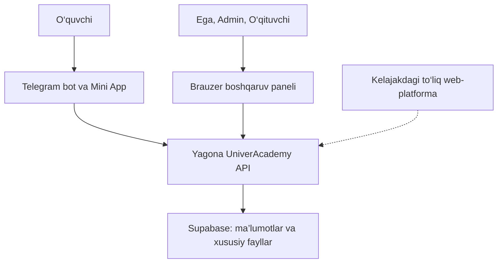

# UniverAcademy MASTER CONTEXT

## 0.7. Amaldagi qisqa ma’lumot — 2026-11-05

**Master 1.5-statistical-bonus-review.1; API 0.2.7-statistical-bonus-review.1. PROVISIONAL / Backend review kutilmoqda.** Joriy talablar §22da. §0–0.6 va16–21dagi oldingi baholash holatlari tarixiy; ularning «joriy» yoki «ochiq» degan eski iboralari yangi talabni bekor qilmaydi.

Hozir **oddiy+o‘qituvchi ixtiyoridagi statistik bonus**. Rasch/1PL/MAP, T/darajalar va A/A+ xatosi keyingi bosqichga muzlatilgan. Eski bonusni olib tashlash qarori `UA-SRC-RESTORE-BONUS-20261105` bilan o‘zgardi. Javobsiz savol bonusda noto‘g‘ri: `UA-SRC-BONUS-UNANSWERED-20261105`.1–127 reyestri va asl manbalar o‘zgarmagan.

GitHub/Supabase/baza/migration/provider/deploy/Dot/agentlar o‘zgartirilmadi. Yangi paket faqat mahalliy hujjat/OpenAPI review. Hech qanday oldingi API yoki agent acceptance yangi baytlarga meros qilinmaydi.

> **Tarixiy 1.0 asos nusxasining qaydi — 30 oktabr 2026, Asia/Tashkent.** Asosiy tuzilma foydalanuvchiga ma’qul; ushbu tahrir uning yakunlash topshirig‘i asosida tayyorlandi. Tasdiqlangan mahsulot qarorlari, keyingi bosqichlar va ochiq texnik masalalar alohida saqlanadi. API Contract, implementatsiya va pilotning tayyorlik holati o‘z dalillari bilan baholanadi. Ushbu ishda faqat shu fayl yangilandi; GitHub, Supabase, Dot, Telegram va Codex agentlariga o‘zgartirish kiritilmadi.

## 0.6. Tarixiy review.3 overlay — 2026-11-05

**PROVISIONAL, NOT ACCEPTED.** Backend remains sole API owner. Current companion API is0.2.6-map-review.3. §§0–0.5 and16–20 preserve their dated history; §21 and current REVIEW-ISSUES.json govern the latest review status. Section13/1–127 remains byte-for-byte unchanged.

Only docs/OpenAPI and local evidence change: terminal status/reason enums and can_calculate=true consistency are repaired in the draft. Numerical boundary defect remains OPEN, with a recommendation but no code/test/profile fix. Direct user message Sentinel_936e922ad45081918da58fa51f33d892 confirms no Admin activation, no old Rasch inheritance on restored attempt, and new-test individual initially off. API/numerical/owner acceptance remains separate. Runtime, production, agent acceptance and broader product approval are not implied.

## 0. Joriy brend va davomiylik: 2026-11-04

**UniverAcademy — avvalgi Qadam loyihasining davomidir; yangi loyiha yaratilmaydi.** Foydalanuvchi belgilagan brend va nomlar [U2] bilan tasdiqlangan. Ushbu `1.1-grading-review.1` nusxasida foydalanuvchining 2026-11-05 baholash qarorlari kiritildi. API shakli Backend/Bot/Panel/QA ko‘rib chiqishi uchun: hujjatdagi texnik yechimlar yoki API avtomatik tasdiqlanmaydi.

| Qism | Joriy nom / identifikator | Dalil va chegara |
|---|---|---|
| Platforma | **UniverAcademy** | U2; tarixiy Qadam nomi dalil matnlari va manba identifikatorlarida saqlanadi. |
| Telegram bot | **@univeracademybot** | U2; username foydalanuvchi bergan. Bot numeric ID, token mosligi, webhook va Mini Appning amaldagi konfiguratsiyasi ushbu hujjat tahririda tekshirilmagan. |
| GitHub | [oybek-muminov/UniverAcademy](https://github.com/oybek-muminov/UniverAcademy) | 2026-11-04 branding paketida muallif read-only tekshiruv natijasi deb qayd etgan (ushbu tahrirda jonli tekshirilmadi): eski Qadam va yangi nom uchun repository ID **1431173135** bir xil. Har bir agentning local remote yoki branchi tekshirildi degani emas. |
| Supabase | **univeracademy-mvp** | 2026-11-04 branding paketida muallif read-only tekshiruv natijasi deb qayd etgan (ushbu tahrirda jonli tekshirilmadi): avvalgi `qadam-mvp` va yangi nomning Project Reference IDsi bir xil: **`hzehnmsutwlauycevcmc`**. Bu faqat nom/identity dalili, schema/RLS/migration yoki pilot tayyorligi tasdig‘i emas. |

**Texnik davomiylik.** Project Reference ID, unga asoslangan amaldagi URLlar, `person_id`, `qadam_id`, `QadamId`, `qadam_private`, `supabase/functions/qadam-api/**`, HTTP yo‘llari, schema va operation IDlar, UUIDlar, manba IDlari va tarixiy xeshlar ushbu brend tahriri bilan o‘zgarmaydi. Matndagi tarixiy **Qadam ID** atamasi avvalgi o‘quvchi identifikatorini anglatadi; yangi ID yoki parallel identity modeli yaratilmaydi. Display nomi brendga moslanishi texnik maydonni rename/backfill qilish ruxsati emas.

**Mas’uliyat.** API uchun yagona mas’ul **Backend**. **Bot/Mini App** va **Panel** o‘z mijoz dasturlari uchun mas’ul; **QA** tekshiradi. Bu taqsimot mavjud texnik chegaralarni almashtirmaydi, yangi arxitektura yoki shu hujjat asosida kodlash/deploy ruxsati bermaydi. Mazkur hujjat va API branding review nusxalarining Backend qabuli hali kutilmoqda; Bot/Panel/QAning yangi xeshlarga reviewi eski qabuldan ko‘chirilmaydi.

**Token va o‘tish cheklovlari.** Eski bot tokenidan foydalanishni to‘xtatish talabi U2dan. Yangi token faqat maxfiy server/muhit sozlamalarida saqlanishi kerak; chat, hujjat, repo, log yoki frontend bundle ichiga kiritilmaydi. Ushbu nusxada token yo‘q, token sozlanmagan yoki bekor qilinmagan. Haqiqiy bot ID, initData tekshiruvi, webhook, Mini App URL/launch sozlamalari va xabar yuborish konfiguratsiyasi xavfsiz o‘tish rejasida alohida tekshirilishi kerak; bu matn o‘tish bajarilganini da’vo qilmaydi.

**Joriy chegaralar.** Tarixiy mahsulot qarorlari va keyingi bosqichlar saqlanadi. Oddiy baholash va statistik bonusning mahsulot qoidalari endi [U3] bilan tasdiqlangan; API maydonlari taklif, javobsiz/son/cohort va boshqa GB qarorlari 16-bo‘limda ochiq. Avvalgi «baholash to‘liq tanlanmagan» qaydi 2026-11-04 holati bo‘lib qoladi. Ma’lumot o‘chirish, yangi Supabase loyiha, migration yoki production deployment bajarilmaydi. 1.0dagi audit va agent holatlari o‘z davrining dalili bo‘lib qoladi; shu brend tahriri bilan joriy bajarilgan ishga aylantirilmaydi. 13-bo‘limdagi asl qaror matnlari va 15-bo‘limdagi eski manba kartalari saqlandi.

**Ko‘rilgan asoslar:** Master Context 1.0 (`2d57d4897beefd1fb152855c291eddc1cc616afecc799fe65c038f085d9bfb09`), API `0.2.2-review-no-grading.2` Markdown (`56023feb118102bffa53efdcde1b63639965c88f2e0d07c9392cba35164deea3`), uning JSON nusxasi (`f98521d8e0adf1611fe455261a0acbb33e489db9794edad3f80d40d43b132062`). Ushbu ishda faqat yangi mahalliy review fayllari yaratildi, asl manbalar o‘zgartirilmadi. APIning `0.2.2-review-no-grading.2` versiyasi o‘zgarmaydi; `branding.1` faqat hujjat review tahriri.

## 0.1. Oddiy va bonus tahririning tarixiy holati — 2026-11-05

**Oddiy baholash va statistik bonus qoidalari foydalanuvchi tomonidan tasdiqlandi** — [U3], U-GR-01–16, 16-bo‘lim. Oddiy hisob darhol saqlanadi; keyingi statistik bonus o‘sha oddiy natija/foizni o‘zgartirmaydi. «Statistik bonusli baholash» standart Rasch modeli emas; rasmiy sertifikat darajasi chiqarilmaydi. Javobsiz savol statistikasi va qolgan ochiq tanlovlar GB-01–GB-08.

Avvalgi hujjat: **1.1-grading-review.1**, yangilanish **2026-11-05**, dastlabki 1.0 tayyorlangan sana **2026-10-30** o‘z holida. APIga moslangan nusxa **0.2.3-grading-review.1** — mahalliy review belgisi, tayyor release yoki agent qabuli emas. API companion: `openapi-UniverAcademy-0.2.3-grading-review.1.json`; matn: `UNIVERACADEMY-API-CONTRACT-0.2.3-grading-review.1.md`. Faqat mahalliy hujjatlar va tekshiruv dalillari tayyorlandi; kod, Supabase/baza, migration, GitHub, deployment, Dot yoki agent holatiga o‘zgartirish kiritilmadi.

**Tarixni o‘qish:** 8–12-bo‘limlardagi eski audit/versiya qaydlari o‘z davrining holati. Quyida ularga joriy izohlar qo‘shildi; 13-bo‘limning avvalgi 1–127 va raqamsiz yozuvlari aynan saqlandi. 2026-11-04 branding fayli yangi baholash qarorlarini bilmagan. Eski «hali tanlanmagan» talqin o‘rniga shu 0.1 va 16-bo‘limlar amal qiladi; original fayllar/xeshlar o‘zgartirilmadi.

## 0.2. Tarixiy Rasch qo‘shilgan tahrir — U5 bilan keyin o‘zgargan

**Uchta mustaqil hisob:** oddiy baholash, statistik bonus va endi haqiqiy Rasch (1PL). [U4] U-R-01–14ga ko‘ra Rasch barcha binary javoblardan θ/b hisoblaydi; javobsiz0, testga kirmaganlar kiritilmaydi, Teacher ballari likelihoodga kirmaydi. Guruh testi va kechikkanlar start oynasi tugagach Teacher xohlasa bir marta boshlaydi; μ/σ, parametrlar va natija muzlatib saqlanadi. Guruh ichidagi Z/T va A+…C chegaralari 17-bo‘limda.

Joriy Master **1.2-rasch-review.1**, API **0.2.4-rasch-review.1** — yangi review taklifi, release/agent qabuli emas. `RASCH_BACKEND_IMPLEMENTATION_PLAN.md` API/DB maydonlari, Backend/Panel/Mini App/QA vazifalari va test rejasini beradi. 30×40 matritsa va executable offline matematik testlar `QA/`da; app/backend yoki production migration bajarilmadi. Original manbalar/tarixiy sanalar saqlandi.

**Supersession aniq:** B/100dagi «faqat oddiy ball/maksimal/foiz, sertifikat darajasi yo‘q» hozir oddiy natijaning darhol chiqishi uchun saqlanadi; U4 endi keyingi mustaqil Rasch darajasini qo‘shadi. U-GR-12ning statistik bonusni Rasch/rasmiy Milliy sertifikatga tenglashtirmasligi o‘z kuchida. Yangi daraja UniverAcademyning **shu guruh ichidagi Rasch darajasi**, tashqi rasmiy equating da’vosi emas. Javobsiz0 faqat Rasch uchun aniqlashdi; bonus **GB-01 ochiq**. R-01–06dagi sonli profil, σ0 ishlovi va API/DB mexanikasi tasdiqlanmagan texnik takliflar.

## 0.3. U5/U6dagi holat — MAP kutilgan tarixiy tahrir

**Statistik bonus bekor qilindi.** Faqat ordinary va **Teacher ixtiyoridagi Rasch1PL**. Yangi testda default45 savol, Teacher o‘zgartiradi; hard limit emas. Individual ball>0, kasr mumkin, ko‘rinish2 kasr va full internal precision. Zona Asia/Tashkent. Rasch statistikasiga faqat current valid self-submitted urinish; expired/forced/cancelled va no-show kirmaydi. Hisobni boshlashdan oldin barcha boshlangan urinishlar va protected late-start/ready-recovery huquqlari tugashi shart.

Joriy Master **1.3-two-grading-review.1**, API **0.2.5-two-grading-review.1**. MAP va σ0 ishlovi hali tasdiq emas, user tushuntirish so‘radi (`MAP_TUSHUNTIRISH.md`). API/DB/core profil texnik reviewda; agent acceptance olinmagan. Manba `USER_DECISIONS_2026-11-05.md` U5/U6, 18-bo‘lim. Ilova/baza/migration/deploy va agentlar o‘zgartirilmadi.

0.1/0.2,16 va eski17dagi bonusni saqlash talablari **tarixiy**: joriy scope18 va ushbu0.3 bilan aniqlanadi. 1–127, barcha oldingi qadam matni/UUID va manba sanalari aynan saqlandi; yangi supersession jadvali qaysi band bekorligini ko‘rsatadi.

## 0.4. Tarixiy holat — MAP va teng natija xabari tasdiqlandi, U7

**MAP ishlatiladi. Hamma Rasch natijasi teng bo‘lib, daraja topilmasa aynan «Rasch darajasini aniqlab bo‘lmadi» ko‘rsatiladi.** [U7] `UA-SRC-MAP-CONFIRMATION-20261105`,2026-11-05. Oldingi «MAP tushuntirish kutilmoqda» va σ0 UX ochiq holati shu user qarori bilan yopildi. Z/T/level null, ordinary ball/maksimal/foiz saqlanadi. Equal raw total guard va sigma floor fake C+/T50 yaratmaydi.

Joriy Master **1.4-map-review.1**, API **0.2.6-map-review.1**. Method va exact matn tasdiqlangan; prior SD1.5/2, gradient1e−7, ddof0/floor1e−8 kabi sonlar **asoslangan texnik tavsiya**, user ularni o‘zi bergan deb ko‘rsatilmaydi. Profil `RASCH_MAP_PROFILE_RECOMMENDED.json`; asoslash `MAP_SETTINGS_RECOMMENDATION.md` va local synthetic study dalili. Eski1/2 candidate current default emas. API/Backend conformance, real-data calibration va runtime/release tekshiruvlari hali yo‘q.

Faqat ordinary va Teacher optional Rasch; bonus bekor;45/editable, self-submitted-only, positive fractional ordinary points/display2/full precision, Asia/Tashkent va bir martalik immutable run o‘zgarishsiz. 1–127 va barcha keyingi reyestr matnlari aynan saqlandi, current overlay19-bo‘limda. Ilova kodi, actual baza/migration/deploy/agent holati o‘zgartirilmadi.

## 0.5. Tarixiy review holati — 0.2.6-map-review.2 / 1.4-map-review.2

**PROVISIONAL REVIEW, NOT ACCEPTED.** Backend yagona API egasi. MAP, exact teng-natija xabari va U5/U6ning barcha mahsulot qoidalari saqlangan; numerical1.5/2 va aynan joint/centered Gaussian varianti esa hali texnik tavsiya. User MAP usullar oilasini tasdiqlagan; unchanged profildagi method=joint_map / USER_CONFIRMED coarse metadata specific variant tasdig‘i emas. Bu paket yuborilgan ZIP asosidagi mahalliy hujjat/dalil reviewi. Kod/QA oracle/test/profile qiymatlari, DB/migration/provider/deployment va haqiqiy agent statusi o‘zgarmadi.

Review.2da P1: original oracleda question permutation sabab T=69.99999999999999/A va70/A+ farqi; RaschRun status/reason hamda readiness schema bo‘shliqlari. Replay rejasida current auth → existing run → first-creation gates tartibi taklif sifatida tuzatildi. Tafsilot §20 va `REVIEW_FINDINGS_AND_DECISIONS.md`; `VALIDATION-RESULTS.json` faqat joriy tekshiruv dalili. Offline pass, user method qarori va API owner acceptance uchalasi bir narsa emas.

Avvalgi 0–0.4 hamda17–19 bo‘limlar ketma-ket tarixiy overlaylar; eskirgan «joriy/current» yoki MAP hali tasdiqlanmagan iboralari U7 va shu0.5/20ni almashtirmaydi. **§13ning barcha matni, jumladan1–127, aynan saqlandi.** `AGENT_REVIEW_TABLE.md`dagi owner acceptance hali olinmagan. Joriy companionlar `UNIVERACADEMY-API-CONTRACT-0.2.6-map-review.2.md` va `openapi-UniverAcademy-0.2.6-map-review.2.json`.

## 1. Hujjatdan foydalanish va dalil qoidalari

Ushbu hujjat UniverAcademyning tekshiriladigan loyiha xotirasi: maqsad, asl qarorlar, keyingi tuzatishlar, MVP chegarasi, texnik kontraktlar, audit va ochiq masalalar bir joyda saqlanadi.

**Dalillar ustuvorligi:** foydalanuvchining aniq talabi va keyingi tuzatishi → shu talabga bog‘langan tasdiqlangan hujjat → hali tasdiqlanmagan kontrakt → assistent yoki agent tavsiyasi. Assistentning «tasdiqlandi» yoki «mening qarorim» degan jumlasi o‘zi foydalanuvchi tasdig‘ini almashtirmaydi. Kontraktdagi yangi cheklov eski foydalanuvchi qarorini avtomatik bekor qilmaydi.

Qarorlar reyestrida ikki jihat ajratiladi:

| Belgi | Mazmuni |
|---|---|
| **T / pilot** | Foydalanuvchi tasdiqlagan, birinchi sinovga tegishli talab. Bajarilgani alohida isbotlanadi. |
| **T / keyin** | Foydalanuvchi tasdiqlagan kelajak talabi; pilotga majburiy qo‘shilmaydi. |
| **A** | Keyingi qaror bilan almashtirilgan yoki doirasi o‘zgargan talab. |
| **H** | Suhbatda bildirilgan tarixiy holat; joriy tizimni jonli tekshirish natijasi emas. |
| **V** | Texnik tavsiya yoki tasdiqlanmagan kontrakt yechimi. |
| **O** | Qaror, dalil yoki muvofiqlashtirish yetishmaydi. |

Reyestrdagi `*` foydalanuvchi javobi raqamsiz bo‘lganini, qadam raqami suhbatdagi bevosita savol/xulosadan bog‘langanini bildiradi. `a/b` takrorlangan asl raqamning tarixiy variantlari; yangi qadam raqamlari emas. `U-` va `P-` ushbu hujjatning raqamsiz talablar uchun tahririy identifikatorlari.

Manba katagidagi **B** — [“Backend arxitekturasi haqida”][B]. Uning yonidagi UUID asl xabar identifikatori. Havola suhbatni ochadi; UUID xabarni aniq topish uchun berilgan. `B/72` — 13-bo‘lim reyestridagi 72-qadam, `C2/178` — v0.2 DOCXdagi, jadvallarni ham qo‘shib sanalgan 178-paragraf. C1/C2 paragraf raqamlari dastlabki tekshiruvda olingan ketma-ketlik bilan saqlandi. J2 uchun aniq JSON pointer yoki endpoint ishlatiladi.

**Manba identifikatori** fayl saqlanadigan papkadan mustaqil: suhbat uchun platforma ID + xabar UUIDsi, hujjat uchun 15-bo‘limdagi mantiqiy ID + asl fayl nomi + SHA256. Hujjat manbalariga havolalar shu fayl ichidagi manba kartalariga olib boradi. Ular yangi bulut arxivi yoki GitHubga yuklangan fayl borligini anglatmaydi.

## 2. Manbalar va tekshiruv qamrovi

| ID | Manba | O‘qilgan qamrov va cheklov |
|---|---|---|
| B | [Backend arxitekturasi haqida][B]; suhbat ID `6ae18475-394c-83ed-91be-11aa3485da51` | Dastlabki yig‘ishda 17 sahifa, 165 muloqot bo‘lagi oxirigacha o‘qilgan. 1.0 uchun so‘nggi Master Context sharhi qayta o‘qildi; hozirgi javob faqat 5 bo‘lak berdi, davom ettirish kursori yo‘q. Eski qadamlar va UUIDlar avval o‘qilgan reyestrdan saqlandi. Biriktirilgan rasm va ayrim eski fayllar mazmuni olinmagan. |
| A | [Qadam v0.2 fayllarini tekshirish][A]; ID `01a188a0-23f1-7a32-9d62-c57bacb55259` | Bir audit ishining so‘rovi, bajarilgan tekshiruvlari va yakuniy xulosasi o‘qildi; eski tarixga kirish cheklovi auditning o‘zida qayd etilgan. |
| C1 | [API Contract v0.1 DOCX manba kartasi][C1] | Dastlab barcha 369 paragraf, jumladan jadvallar o‘qilgan; matnning OOXMLga mosligi tekshirilgan. 1.0da asl fayl SHA256si yana tekshirildi. |
| C2 | [API Contract v0.2 DOCX manba kartasi][C2] | Dastlab barcha 324 paragraf o‘qilgan, OOXMLga mosligi tekshirilgan. 1.0da SHA256si yana tekshirildi. Kontraktning o‘zi tasdiqlash loyihasi bo‘lib qoladi. |
| J2 | [OpenAPI v0.2 manba kartasi][J2] | Asl JSON, versiya va auditga tegishli sxemalar dastlab ko‘rilgan; 1.0da asl fayl xeshi yana tekshirildi va E bilan mos. |
| F | [Mustaqil audit manba kartasi][F] | F1–F7, sakkiz tuzatish va tekshiruv chegaralari dastlab to‘liq o‘qilgan. 1.0da audit fayliga SHA256 identifikatori qo‘shildi. |
| E | [Tekshiruv dalillari manba kartasi][E] | Ijobiy/salbiy misollar, kutubxona versiyalari va manba xeshlari dastlab o‘qilgan. 1.0da dalil fayliga SHA256 identifikatori qo‘shildi. |
| L | Dastlabki mahalliy manba inventari | Dastlabki yig‘ishda `sources/` va ro‘yxatdagi boshqa mahalliy Qadam papkasi bo‘sh bo‘lgan. Bu inventar tarixiy tekshiruv qaydi; manba identifikatori kompyuter yo‘liga bog‘lanmaydi. |
| U0 | Dastlabki Master Context topshirig‘i | 10–30 o‘quvchilik MVP, qarorlarni manbaga bog‘lash va tashqi tizimlarni o‘zgartirmaslik uchun bevosita foydalanuvchi manbasi. |
| U1 | [1.0ni yakunlash topshirig‘i manba kartasi][U1] | 2026-10-30dagi joriy foydalanuvchi topshirig‘i: sana, barqaror IDlar, O-01–O-03, pilot indeksi, keyingi bosqichlar va v0.2.1ning dalilga asoslangan holati. |

Auditdagi `work/validation.json` va `work/audit.py` yordamchi dalil materiallaridir; o‘rnatilgan `validator_lib` kutubxonalari Qadam mahsulot talablari manbasi emas. Asl v0.1 OpenAPI fayli bu tekshiruvda topilmadi. Dastlab suhbatga qo‘shilgan ikki eski hujjatning nomi va to‘liq mazmuni qaytmadi. Ularni C1/C2 bilan tenglashtirmaymiz.

**Tarixiy sana tekshiruvi:** asos hujjatning **yakuniy 1.0 tahriri tayyorlangan va yangilangan sana — 2026-10-30 (Asia/Tashkent)**. Asl 1.0dagi `prepared_on` va `updated_on` shu tahrirga tegishli edi; joriy nusxada `prepared_on` tarixiy 2026-10-30 sifatida saqlandi, `branding_review_prepared_on` 2026-11-04 bo‘lib qoladi, `updated_on` esa yangi baholash tahriri sanasi 2026-11-05. Dastlabki faylning yaratilish metadatasi `2026-10-21 14:27:28 UTC`; 0.1-draftdagi 21-oktabr sanasi tarixiy qayd sifatida jurnalda saqlandi. Faylning yaratilish belgisi manbalarning mazmuniy tarixini aniqlamaydi. Asl manbalardagi 2026-10-28, 2026-10-29 va 2026-10-29 16:44 UTC tarixiy sanalari o‘zgartirilmadi. Manba sanasi, ma’lumotnoma tahriri sanasi va imtihon konfiguratsiyasining sana-vaqti alohida saqlanadi.

## 3. UniverAcademyning maqsadi va mahsulot yo‘nalishlari

**UniverAcademy — ko‘p fanli mustaqil ta’lim platformasi.** Birinchi fan fizika, chunki uning materiallari tayyor. Bu loyihani faqat fizikaga ixtisoslashtirmaydi. Auditoriya: 7–11-sinf o‘quvchilari, Milliy sertifikat va OTM kirish imtihoniga tayyorlanuvchilar. B/1–3.

Asosiy mahsulot mustaqil ta’limdir: fan va maqsadni tanlash, ixtiyoriy diagnostika, mos o‘quv yo‘li yoki noldan boshlash, videodars, mashq va testlar. Guruhga kirish mustaqil ta’limning sharti emas. Bu foydalanuvchi tomonidan keyin alohida tuzatilgan. B/U-01, 3–15, 57–64.

| Yo‘nalish | Tasdiqlangan mazmun | Pilotdagi holati |
|---|---|---|
| Mustaqil ta’lim | O‘z tezligida o‘qish; ko‘p darajali fan/bo‘lim/dars; progress | Keyin |
| Mustaqil demo imtihon | Yo‘l xaritasi yoki guruhsiz ham foydalanish; backend avval ishlanmagan testni tanlaydi; test raqami va ruxsat bergan shaxs ko‘rsatilmaydi | Talab saqlanadi; hozirgi guruh piloti doirasidan tashqarida |
| Guruhli demo imtihon | O‘qituvchi ochgan test, sana-vaqt, guruh/individual ruxsat, monitoring va natijalar | Birinchi MVP |
| Guruhli jonli tahlil | Qo‘shimcha xizmat; kelajakda obuna bilan | Birinchi sinovdan keyin |
| To‘lov va obuna | Kelajakda birinchi mustaqil test bepul, keyingilari pullik; fan yo‘lini tugatganga yana bitta bepul imkoniyat | Narxlar va mexanizm tanlanmagan |
| To‘liq web-platforma | Ta’lim yo‘llari, darslar va boshqa funksiyalar | Pilot uchun to‘liq qayta qurish talab qilinmaydi |

Foydalanuvchida **40 xil fizika demo testi** mavjudligi bildirilgan; ularning barchasi tizimga yuklangan degan dalil yo‘q. Avval bitta haqiqiy test, so‘ng qolgan 39 tasi. Taxminan ikki oylik guruh dasturi guruhning majburiy tugash muddati emas. Yangi a’zo mavjud dasturga darhol qo‘shiladi. Guruh to‘lishi bo‘yicha avtomatik yangi guruh yaratish yoki son chegarasi talab sifatida kiritilmaydi. B/67, 101, U-01.

## 4. Foydalanuvchilar, rollar va huquqlar

| Rol | Foydalanuvchi tarixida tasdiqlangan huquq va cheklovlar | Ajratilishi kerak bo‘lgan texnik masala |
|---|---|---|
| O‘quvchi | Telegram orqali hisob; Mini App ichida ism-familiya; o‘ziga ruxsatli test va o‘z natijalari. Mustaqil ta’lim uchun guruh shart emas. Bir vaqtda bitta faol guruh. B/18, 73–74, 80–82, 113–116 | Hisoblarni xavfsiz bog‘lash va sessiya muddati — kontrakt yechimi/tanlovi; ism orqali hisoblarni birlashtirishga asos yo‘q. |
| O‘qituvchi | Mustaqil ro‘yxatdan o‘tadi; Admin dastlabki kirish va tanlangan fanlarni tasdiqlaydi. Tasdiqlangan fanidagi barcha demo kontentni boshqaradi, o‘quvchi/natijada faqat o‘z guruhlarini ko‘radi. B/76b–78, 91 | Fan kontentiga keng huquq boshqa guruh o‘quvchilari ma’lumotiga huquq bermaydi. |
| O‘qituvchi — guruh ishlari | Guruh yaratish so‘rovini yuboradi, Admin tasdiqlaydi. O‘quvchini ro‘yxat yoki Qadam ID orqali topib, o‘z guruhiga qo‘lda qo‘sha oladi. B/72–73, 106, 114 | Bu tasdiqlangan huquq saqlanadi. v0.2dagi Teacher uchun faqat so‘rov yuborish cheklovi tasdiqlanmagan; kontrakt O-01ga moslashtirilishi kerak. B/81dagi guruhlararo ko‘chirish Admin vakolati bo‘lib qoladi. |
| Admin | Barcha guruhlarni ko‘radi. O‘quvchini guruhlar orasida ko‘chiradi, tarix saqlanadi. Ega huquqlarini o‘zgartira yoki Egani chetlata olmaydi. Yangi Admin tayinlamaydi; boshqa Adminni chetlatish uchun so‘rov bera oladi. B/81–82, 91, 102–105 | Barcha guruhni ko‘rish barcha o‘zgartirishga cheksiz ruxsat degani emas. Aniq vakolat doiralari tanlanishi kerak. |
| Ega / Owner | Barcha huquqlar, fan/test boshqaruvi, Admin tayinlash, xodim huquqlari va chetlatish; Adminning so‘rov huquqini ham bekor qilishi mumkin. B/103–105 | Dastlabki Ega hisobini tayinlash, oxirgi Egani yo‘qotishdan himoya — texnik taklif. |

Qo‘shimcha aniqliklar:

- Mavjud O‘qituvchining fan huquqini qo‘shish/olib tashlash Admin taklifi va **Ega tasdig‘i** bilan; bu dastlabki o‘qituvchi ro‘yxatdan o‘tish tartibini o‘zgartirmaydi. B/104–105. Assistentning 104-qadamdan keyin dastlabki onboardingni ham Egaga o‘tkazgan talqini foydalanuvchining 105-qadam aniqligi bilan mos kelmaydi.
- Bir guruhda turli fanlar bo‘yicha bir nechta o‘qituvchi bo‘lishi mumkin; ularni Ega yoki Admin biriktiradi. B/107–108.
- Xodimlar Google yoki email/parol bilan brauzer paneliga kiradi. Bu tanlov hozir provider sozlamasini o‘zgartirishga ruxsat emas. B/75, 105; U0.
- Ega so‘rov haqida Telegram xabari oladi; tasdiqlash/rad etish brauzer panelida bajariladi. B/104. v0.2dagi aniq Telegram bog‘lash va rozilik mexanizmi hali sozlanmagan.
- Majburiy yakunlash va texnik qayta ochish oddiy O‘qituvchiga berilmagan. Tarixda «administrator», v0.2da esa Ega yoki aniq vakolatli Admin ishlatilgan; aniq Admin capability/scope tanlovi ochiq. B/83–84, 93–94; C2/81, 138–141.
- Administrator imtihon jarayoni tugagach tahlil muddatini uzaytirishi yoki qayta ochishi mumkin. Ega barcha huquqlari bilan bu amalni ham bajaradi. v0.2dagi Owner-only toraytirish foydalanuvchi tomonidan tasdiqlanmagan va amaldagi mahsulot qarorini almashtirmaydi; O-02. Adminning aniq vakolatni berish/bekor qilish mexanizmi alohida texnik loyiha masalasidir.

## 5. Mustaqil ta’lim, darslar va testlar

### 5.1. Diagnostika va o‘quv yo‘li — keyingi bosqich

Ixtiyoriy bitta diagnostika: 30 savol, besh fizik bo‘limdan olti tadan, har bo‘limda 2 oson + 2 o‘rtacha + 2 qiyin. Bo‘limlar: mexanika; molekulyar fizika va termodinamika; elektr va magnetizm; optika; atom va yadro fizikasi. Umumiy ball 30; bilim tahlilida 1 / 1,5 / 2 og‘irliklar. Zaif/o‘rtacha/kuchli chegaralari aniqlanmagan va 15-qadamda keyinga qoldirilgan. B/4–15.

Tizim yo‘l tavsiya qiladi; o‘quvchi uni qabul qilishi yoki noldan boshlashi mumkin. Barcha bo‘limlar o‘qiladi, zaiflari ko‘proq dars/mashq, kuchlilari qisqaroq takrorlash oladi. B/11–12. Bu diagnostika pilotdagi sertifikat demo imtihoni bilan bir xil test emas.

### 5.2. Dars va bo‘limlar — keyingi bosqich

Fan → ichma-ich bo‘limlar → videodarslar → mashqlar → dars testi. Har bir kichik va yuqori bo‘lim uchun alohida yakuniy test bo‘lishi mumkin. Bo‘lim chuqurligi, videolar va savollar sonini o‘qituvchi belgilaydi. Fan oxirida sertifikat darajasidagi yakuniy imtihon ochiladi. B/57–58.

| Tekshiruv turi | Amaldagi mahsulot talabi |
|---|---|
| Video ortidagi mashq | Darhol tekshirish va tushuntirish; xato savol qayta berilmaydi. Eski 23–26 doirasi 57-qadam bilan o‘zgargan. |
| Videodars testi | Oxirida xatolar bir marta qayta beriladi. Tuzatilsa ballga qo‘shiladi; ikkinchi xatoda tushuntirish, uchinchi urinish yo‘q. |
| Bo‘lim testi | Test tugagach tushuntirish, savol ichida qayta berish yo‘q. O‘tish uchun **70% dan yuqori**; aynan 70% yetmaydi. O‘ta olmasa faqat test qayta topshiriladi; videolar ochiq qoladi. Urinishlar soni cheklanmaydi. |
| Bo‘lim testini qayta topshirish | Imkon qadar ishlanmagan savollar; bank yetmasa takror bo‘lishi mumkin. |
| Fan/demo imtihoni | Odatda bitta imkoniyat; qat’iy vaqt, pauzasiz. Texnik nosozlik uchun ruxsatli alohida urinish istisnosi bor. |

Sonli javob, tolerantlik, savolda o‘lchov birligi, 1/2/3 ball va qiyinlik taqsimoti o‘quv testlari uchun tasdiqlangan. Ular to‘rtta variantli birinchi demo uchun avtomatik qo‘shilmaydi. B/27–36, 58–64, 99.

Videodars va savollar qoralama → tekshirish → nashr; keyingi tahrirda yangi versiya, eski natijalar va tarix saqlanadi. Savolni arxivlash yangi testlardan chiqaradi, tarixni o‘chirmaydi. Video fayl yoki tashqi havoladan qo‘shiladi; tashqi havola webda ishlashi mumkin, Telegramda bevosita video uchun fayl tayyor bo‘lishi kerak. B/41–50.

Video yangilanganda majburiy/ixtiyoriy qayta o‘qish va uning hajmini o‘qituvchi belgilaydi. Majburiy vazifa tugaguncha yangi darslar ochilmaydi, eski ochilgan darslar saqlanadi. Bildirishnoma, Telegram xabari, o‘qituvchi tanlaydigan qisqa tekshiruv soni/foizi bor. B/49–56. 47-qadamdagi umumiy nashr sharti bilan 46-qadamdagi web-only nashr imkoniyatining aniq talqini O-06da saqlangan.

## 6. Birinchi MVP va qabul mezonlari

**2026-11-05 izohi:** birinchi demo doirasi 10–30 o‘quvchi, bitta fizika testi va Telegram Mini App bo‘lib qoladi. Oddiy baholash endi U-GR-01–04 bilan aniq. Statistik bonusning mahsulot qoidalari ham tasdiqlangan, ammo uni aynan birinchi demo pilotiga kiritish navbati belgilanmagan (GB-08); bu yerda jim majburiy pilot mezoniga yoki bekor kelajak g‘oyasiga aylantirilmaydi. 6.1 tarixiy indeks, joriy baholash mappingi 16-bo‘limda.

**Maqsad: `@univeracademybot` → Telegram Mini App orqali bir vaqtning o‘zida 10–30 o‘quvchiga bitta haqiqiy fizika demo imtihonini o‘tkazish.** U0; B/66, 101, 117–123 va keyingi texnik muloqotlar.

### 6.1. Birinchi demo imtihon qarorlarining alohida indeksi

Bu jadval 13-bo‘limdagi asl reyestrga ko‘rsatkichdir. **T** — tasdiqlangan mahsulot talabi; **H** — mavjudlik haqida bildirilgan holat; **V/O** — hali tanlanadigan texnik yechim yoki tekshiruv. Eski A variantlar pilot talabi sifatida qayta kiritilmaydi.

| Yo‘nalish | Asl qaror IDlari | Birinchi pilotda qo‘llanadigan qism | Holat |
|---|---|---|---|
| Maqsad va hajm | 1, 65–66, 101, 117, 119–120; P-04 | Fizika, bitta haqiqiy demo, Telegram Mini App, bir vaqtda 10–30 o‘quvchi; avval guruh sinovi | T |
| Bot manzili | 111–112; U-BR-01 | `@univeracademybot`; U2dagi joriy bot. `@UmumiyFanlarBot` tarixiy manzil sifatida saqlanadi | Joriy username — foydalanuvchi talabi; 112 — eski bot haqidagi H, yangi integratsiya yoki ishlaydigan imtihon dalili emas |
| Ro‘yxatdan o‘tish | 18, 73–74, 113 | Telegram orqali hisob va Mini App ichida ism-familiya; faqat ruxsatli guruh testi | T; 18dagi keyingi web hisobini bog‘lash pilotga majburiy emas |
| Test ko‘rinishi va jadval | 68b, 69–71 | Bankning jami soni yashirin; ruxsatli/tarixiy testlar; guruh/individual ruxsat; start oynasi; boshlangan imtihonga to‘liq vaqt | T; 68a almashtirilgan |
| O‘quvchini guruhga qo‘shish va ko‘chirish | 72–73, 80–82, 114 | Teacher qo‘lda qo‘shadi; faqat bitta faol guruh; ko‘chirish Admin orqali; eski natija va tarix saqlanadi | T; O-01 — kontrakt mosligi; faol imtihondagi ko‘chirishning aniq mexanizmi V/O |
| Rollar va guruh boshqaruvi | 75, 76b–78, 91, 102–106, 108 | Brauzer paneli, dastlabki teacher/fan tasdig‘i, fan kontenti va own-group natija doirasi, Ega/Admin farqi, group-create so‘rovi | T; 76a almashtirilgan; vakolatlarning aniq texnik sozlamasi V/O |
| Kontent va baholash | 42–43, 64, 85, 99 | Tekshirilgan/nashr qilingan bir demo, versiya/tarix, qat’iy vaqt, fixed savol tarkibi va aralashtirilgan tartib; baholash usulini Teacher tanlaydi | T; aniq pilot kaliti/duration/ballari O; O-03dagi const texnik cheklov |
| Kontentni tayyorlash yordami | 67; P-07 | Bir testni moslab tayyorlash va texnik format tanlash vakolati | Ish tartibi; tayyor savol/rasm/kalit dalili emas. To‘liq Word/Excel/PDF import mahsuloti pilotga avtomatik majburiy qilinmaydi |
| Imtihon va texnik istisno | 83–84, 93–94 | Pauzasiz imtihon; vaqt tugasa yakun; administratorning force-finish/recovery amali; yangi bo‘sh urinish, to‘liq vaqt, cancelled tarix | T; Teacherga bu vakolat avtomatik berilmaydi |
| Boshlash va yakunlash interfeysi | 95–98 | Boshlash/yakunlash tasdig‘i; javobli/javobsiz soni; bittadan savol va erkin navigatsiya; bookmark yo‘q | T |
| Ball va hisobot | 89–90, 100; endi U4 | Darhol oddiy ball/maksimal/foiz; keyin optional Rasch darajasi; Teacher monitoringi va Excel | B/100 tarixiy cheklovi Rasch qo‘shimchasi uchun U4 bilan aniqlashtirilgan; polling/performance V |
| Batafsil yozma tahlil | 86–88, 92–93ning istisno qismi | Kirish oynasi yopilib, boshlangan imtihonlar tugagach; guruhga auto/teacher tanlovi; kun oxiri; Admin uzaytirishi/qayta ochishi | T; O-02 — kontrakt mosligi. 92dagi keng statistika va guruhli jonli tahlil keyin |
| Kabinet va bosh sahifa | 118, 121 | Ega va Teacher rollari ajratilgan kabinetlar; kelajak bo‘limlari «Tez kunda» | T; jismoniy saytlar soni/dizayn O |
| Telegram xabarlari | 122–123 | Oldindan eslatma va test ochilish xabari; eslatma vaqtini Teacher har guruh testi uchun belgilaydi | T; yetkazish/rozilik/navbat mexanizmi kontraktdagi texnik loyiha |
| MVPdan chiqarilgan funksiyalar | 117, 120; 115–116dagi keyingi xizmatlar | Oynadan chiqishni aniqlash, avtomatik jazolash va jonli tahlil birinchi sinovdan keyin; mustaqil test xizmati va to‘lovlar ham keyingi bosqich | T — bosqich chegarasi; talablar o‘chirilmagan |
| Resurs va ish tartibi konteksti | 124–127; P-01–P-03 | Supabase/agentlar haqida tarixiy ma’lumot, Dot koordinatsiyasi, avval kontraktni kelishish | H va ish tartibi; deploy yoki bajarilgan pilot dalili emas |

**Keyingi bosqichlar saqlanadi:** diagnostika va mustaqil ta’lim (3–15, 17, 19–63ning ta’lim qismi), videodars va kontent boshqaruvi, mustaqil testlar (115–116, U-01–U-02), obuna/to‘lov va rasmiy baholashga moslashuv (99ning kelajak qismi). Ushbu pilot indeksi ularning bekor qilinganini anglatmaydi. «Hozir to‘lovsiz» talabi ham to‘lov tizimini pilotda yaratish majburiyati emas.

### 6.2. Minimal pilot oqimi

Minimal oqim:

1. O‘quvchi botdan Mini Appni ochadi, Telegram orqali taniladi, ism-familiyasini kiritadi.
2. Guruh/individual ruxsat va jadvalga mos test hamda yo‘riqnomani ko‘radi. Jami testlar soni oshkor qilinmaydi.
3. Shartlarni ko‘rib, boshlashni tasdiqlaydi; vaqt shundan boshlanadi.
4. Savollar bittadan; raqamlar panelida javobli/javobsiz farqlanadi. Erkin qaytish va javobni o‘zgartirish mumkin. Alohida bookmark yo‘q.
5. Savol va variantlar aralashtiriladi, ayni urinish davomida tartib o‘zgarmaydi. Javoblar serverda saqlanadi, vaqt serverda nazorat qilinadi.
6. Pauza yo‘q. Yangi startlar uchun guruh yopilishi oldin boshlangan imtihon vaqtini qisqartirmaydi. Vaqt tugashi yoki tasdiqlangan yakunlash urinishni tugatadi.
7. Yakunlash tasdig‘ida bajarilgan/javobsiz sonlar ko‘rsatiladi. Darhol oddiy ball, maksimal ball va foiz. U4dan keyin alohida bir martalik Rasch hisobi bo‘lsa, qo‘shimcha guruh ichidagi daraja ko‘rsatiladi; oddiy natija uni kutmaydi.
8. O‘qituvchi o‘z guruhini kuzatadi, yakunlangan natijalarni darhol ko‘radi, jadval va Excel hisobotidan foydalanadi. Ega va O‘qituvchi kabinetlari rollar bo‘yicha ajratilgan.
9. Batafsil javob/yechim tahlili alohida ochiladi: guruhning kirish oynasi tugashi **va** oxirgi boshlangan urinish yakunlanishi kerak. Guruh uchun auto yoki teacher approval tanlanadi. Odatda ochilgan kun oxirigacha; administrator jarayon tugagach muddatni uzaytirishi yoki qayta ochishi mumkin. O-02da tasdiqlangan qoida va kontrakt farqi ajratilgan.
10. Texnik qayta ochish yangi bo‘sh urinish va yangi to‘liq vaqt beradi; oldingisi bekor qilingan tarixda saqlanadi. Odatdagi ikkinchi urinish huquqiga aylantirilmaydi.

Birinchi sinovda oynadan chiqishni aniqlash va avtomatik jazolash **keyinga qoldirilgan**; nazoratchilar bo‘ladi. Jonli tahlil ham keyin. To‘lov, obuna, video, diagnostika/adaptiv ta’lim hozir majburiy emas. «Fanlar», «Yo‘l xaritasi», «Videodarslar» bo‘limlari «Tez kunda» holatida ko‘rinishi tasdiqlangan. B/117, 120–121.

**Talab qilingan natija va bajarilgan testni ajratish:** haqiqiy 10–30 o‘quvchilik sinov o‘tkazilgani topilmadi. Audit tavsiya qilgan 30 parallel lifecycle, nol yo‘qolgan tasdiqlangan javob, nol takror natija/ma’lumot sizishi va `p95 ≤ 3s` hali test natijasi emas; oxirgi ko‘rsatkich taklif. [F], C2/289.

## 7. Tizimlar va agentlar vazifalari

Bu tasdiqlangan umumiy yo‘nalish va kontraktda taklif etilgan texnik model tasviri; amalda to‘liq ulangan tizimning inventari emas. B/75, P-01, C2.

| Qism | Vazifa | Dalil va holat |
|---|---|---|
| GitHub `UniverAcademy` | Kod, versiyalar, kontrakt va tekshiruv dalillari uchun umumiy manba | [oybek-muminov/UniverAcademy](https://github.com/oybek-muminov/UniverAcademy), repository ID `1431173135`: 2026-11-04 read-only tekshiruvda eski Qadam bilan identity bir xil. Agent local remote/commit holati alohida tekshiriladi. 1.0dagi `docs/QADAM_MASTER_CONTEXT.md` taklifi tarixiy; ushbu nusxa repo ichiga push qilinmadi. |
| Supabase `univeracademy-mvp` | Baza, staff Auth, fayllar; taklifdagi Edge Functions orqali biznes qoidalari | 2026-11-04 read-only tekshiruvda avvalgi `qadam-mvp`ning Project refi `hzehnmsutwlauycevcmc` saqlangani qaytarildi. Reference URLlar o‘zgartirilmaydi; amaldagi schema/RLS yoki har agent ulanishi shu dalil bilan tasdiqlanmaydi. |
| Telegram `@univeracademybot` | Kirish nuqtasi, Mini App, eslatma/ochilish xabarlari; kelajakda video | U2dagi joriy username. B/111–113dagi `@UmumiyFanlarBot` tarixiy. Yangi bot ID/token/webhook/Mini App mosligi va haqiqiy sinov hali ushbu tahrirda tekshirilmagan. |
| Dot | Mavjud agentlarni boshqarish, topshiriq va kelishmovchiliklarni muvofiqlashtirish, foydalanuvchiga paket qaytarish | Foydalanuvchi ishni Dot bilan olib borishini aytgan. Ushbu ishda Dotga murojaat yuborilmadi. |
| Backend Codex | API uchun yagona mas’ul; konseptual sxema, xavfsizlik, vaqt/baholash va keyingi backend | U2 API egaligini tasdiqlaydi. Ushbu branding nusxalarining Backend reviewi kutilmoqda; kod va bazaga ish boshlash ushbu hujjat bilan ruxsat etilmaydi. |
| Bot Codex | Telegram/Mini App oqimi va kontraktni mijoz sifatida tekshirish | Ro‘yxatdan o‘tish, start, save, result/review, auth va xabar payloadlari mosligini ko‘radi. |
| Panel Codex | O‘z Panel dasturi uchun mas’ul; Ega/O‘qituvchi amallari uchun kontraktni tekshirish | U2dagi mas’uliyat. 1.0da kodlashni to‘xtatish haqidagi tarixiy holat saqlanadi; joriy kod/tayyorlik holati shu hujjat bilan tasdiqlanmaydi. Dizayn, menyu va sahifalar ushbu brend tahririda tanlanmagan. |
| QA | Kontrakt va mijozlar mosligini, regressiyani tekshirish | U2; yangi branding fayllariga QA reviewi va runtime/pilot tekshiruvi kutilmoqda. |
| Web agent | Mavjud tashrif sahifasi; kelajakdagi web ishlar | Eski agent javob bermayotgani foydalanuvchi orqali bildirilgan; kodi/tarixi yo‘qolgan degan dalil yo‘q. |
| Foydalanuvchi + Work | Mahsulot talabi, manbalar taqqoslashi, audit va tasdiq | Agentlar reviewi foydalanuvchi tasdig‘iga teng emas. |

Texnologiyalar bo‘yicha suhbatda foydalanuvchi tanlovni assistentga bergan: React + TypeScript, Supabase, Edge Functions, KaTeX, Storage tanlangan; bu amalga oshirilgan stackning tekshiruvi emas. C2dagi egalik taklifi: Backend — `supabase/migrations/**`, `supabase/functions/qadam-api/**`, `tests/backend/**`; Bot — `apps/telegram-bot/**`, `apps/mini-app/**`; Panel — hozir review. B/67; C2/290. Webhook adapteri va outbox dispatcherining yakuniy kod egasi hali kelishilishi kerak.

Backend biznes qoidalarini interfeysdan ajratish va kelajakdagi webni API orqali almashtirish — so‘nggi arxitektura tavsiyasi. Foydalanuvchi hozir webni ortiqcha o‘zgartirmasdan testni tezroq ishga tushirish istagini bildirgan; to‘liq yangi web arxitekturasi tasdiqlanmagan. B/P-04.

## 8. API Contract versiyalari va audit

**Joriy qo‘shimcha, 2026-11-05:** `0.2.2-review-no-grading.2` fayllari va `branding.1` paketidan keyin **0.2.3-grading-review.1** mahalliy review nusxasi tayyorlandi. Foydalanuvchining yangi baholash qoidalari unga kiritildi. Asl v0.2.1 fayllari hali yo‘q; v0.2.1 tayyorligi haqidagi tarixiy bo‘shliq bu bilan yopilmadi. Yangi nusxaga Backend/Bot/Panel/QA qabuli olinmagan, eski acceptance ko‘chirilmaydi. Manba xeshlari 15.10/16-bo‘limda. Quyidagi v0.1/v0.2/audit qaydlari tarixiy.

### 8.1. Versiyalar

| Versiya | Dalil | Amaldagi holati |
|---|---|---|
| v0.1 | [C1]; asos lokal commit `2a27d43`, branch `planning/backend-physics-pilot-approval` deb yozilgan | Tasdiqlanmagan tarixiy loyiha. Sakkiz mahsulot farqi aniqlangan. 37 amal/52 sxema tekshirilgani muallif xabari; bu ishda asl companion ko‘rilmadi. |
| v0.2 | [C2], [J2], [F], [E]; asos commit `c2e689ceec5b471bf76b09573df91c0184c51615` deb yozilgan | Asosiy sakkiz yo‘nalish yaxshilangan; OpenAPI struktura validatsiyasi o‘tgan. F1–F6 ochiq; yakuniy foydalanuvchi tasdig‘i topilmadi. |
| v0.2.1 | B, assistent xabari `19e185e2-e0d5-42f8-831f-db0e95e66fb7`; so‘nggi sharh `f63ca5bb-f567-467c-ad6e-c49d25c7212d` | **Tayyorligi tasdiqlanmagan.** Tuzatish paketi kutilayotgani aytilgan; taqdim etilgan manbalarda yakuniy Contract/OpenAPI fayli, exact xeshlar, yakuniy Bot/Panel reviewi va foydalanuvchi tasdig‘i yo‘q. Ish davom etayotgani haqidagi xabar tayyor paket dalili emas. |

Kontrakt versiyasi `v0.2` va HTTP yo‘llari prefiksi `/api/v1` boshqa tushunchalar. OpenAPI dialekti `3.1.0`. Bu hujjat ularni qayta nomlamaydi.

v0.2 Word qaydiga ko‘ra Bot va Panel aynan yakuniy Markdown/JSONni 2026-10-29 16:44 UTCda qabul qilgan: Bot review ID `01a18886-9843-7643-91b9-4a7a39ac470d`, Panel ID `01a1888b-03e7-74b0-a11c-887c0eaf1ae5`. Bu ma’lumot C2/319–324dan; ushbu alohida agent suhbatlari jonli qayta tekshirilmadi. Keyingi mustaqil audit topilmalari bu review bilan bekor bo‘lmaydi.

### 8.2. Asl fayllarning SHA256 identifikatorlari

Quyidagi uch asl faylning xeshi dastlabki tekshiruvda va 2026-10-30dagi 1.0 tahririda qayta olindi va E bilan mos. Joylashuvdan mustaqil to‘liq manba kartalari 15-bo‘limda:

| Fayl | SHA256 |
|---|---|
| API Contract v0.1 DOCX | `480ec59a97ff34afb5f969649a11362ce9153bdc666cc8e0bbadc984f463e81c` |
| API Contract v0.2 DOCX | `766f6750b514ebf5a14e21e1a670517d3b409a891108e7368b2737a786ddcdb5` |
| OpenAPI v0.2 asl JSON | `c9bf2242e87cfff9df96f19a678b7275a7b2dced0fd4368bf69cea2955d8e4f1` |

C2/319dagi Markdown xeshi `2e31caece89f264b0a6b1fe6f34f80dfe65afab5984712afe6a2d6e0b1f50605` muallif qaydi sifatida saqlandi; asl Markdown fayli topilmadi. Bu DOCX xeshi emas. Ishchi `openapi.json` qayta formatlangan bo‘lishi mumkin; asl JSON baytlarini uning xeshi bilan almashtirmang.

### 8.3. v0.1dagi sakkiz farq va v0.2 holati

| № | Talab/manba | v0.1dagi farq | v0.2/audit holati |
|---|---|---|---|
| 1 | B/70: boshlangan imtihonga to‘liq vaqt | `min(start+duration, close)` | `start+duration`, close faqat yangi startga. Matnda tuzatilgan; runtime sinalmagan. |
| 2 | B/84: toza texnik yangi urinish | Eski javob/tartibni nusxalash | Eski urinish cancelled, yangi bo‘sh/full duration. Matnda tuzatilgan. |
| 3 | B/86–88, 100: darhol ball, keyin tahlil | `withheld/after_close` va tahlil ajratilishi yetarli emas | Sinxron ball + alohida review gate; F4 sxema muammosi qolgan. |
| 4 | B/93: o‘qituvchi force/recovery qilmaydi | Teacher capabilityga ochiq taklif | Ega/vakolatli Admin; aniq scope tanlanishi kerak. |
| 5 | B/80–82: bitta faol guruh va demo bir marta | Faqat student+assignment series | Stable demo va student+demo series/unique membership taklifi; DBda hali isbotlanmagan. |
| 6 | B/57, 67: ko‘p formula/rasm/izoh | Bitta optional formula/image, izohlar yetishmaydi | Block modeli, xususiy media va purpose; F3/F5 ochiq. |
| 7 | B/122–123: ikki Telegram xabari | Yetarli mexanizm yo‘q | Inbox/outbox, dedupe, consent va unknown delivery dizayni; real send sinalmagan. |
| 8 | B/76–78, 91, 103–108: rollar va approval | Tarixdagi oqimlar yetarli emas | Kengaytirilgan; F1/F2 va quyidagi O-01/O-02 kabi tarixiy farqlar saqlanadi. |

Manba: [F]ning sakkiz bandli jadvali, C1/C2. «Matnda tuzatilgan» — bajarilgan server testi emas.

### 8.4. Mustaqil audit topilmalari

| ID | Daraja | Muammo va aniq manzil | Tavsiya / mas’ul | Yopilish dalili |
|---|---|---|---|---|
| F1 | P1 | `ApprovalRequest.properties.payload`: `type` va payload mustaqil; recovery turi group-create payloadini qabul qiladi | Backend: 9 turga ajratilgan response yoki shartli bog‘lash; Panel/Bot salbiy misollar | Topilmadi; ochiq |
| F2 | P1 | `TeacherAssignment` direct replace/[] ishlatadi; `TeacherAssignPayload`da operation yo‘q, minItems=1, unique yo‘q | Backend + Panel: ikkala oqimda bir xil almashtirish ma’nosi, bo‘shatish/takror/revision testlari | Topilmadi; ochiq |
| F3 | P2 | `VersionCreate.instructions_blocks` uchun rasm yuklangandan keyin draftni yangilash yo‘li yo‘q | Backend + Panel: draft-only tahrir yoki boshqa aniq asset oqimi. `PATCH /admin/versions/{version_id}` — taklif, mavjud endpoint emas | Topilmadi; ochiq |
| F4 | P2 | `Score`, `Attempt`, `DetailedReview`, `ReviewGate` holatlari yetarli bog‘lanmagan; available ball null, terminal savol to‘la bo‘lishi mumkin | Backend sxemalarni kuchaytiradi; Bot status/ball/gate misollarini tekshiradi | Topilmadi; ochiq |
| F5 | P2 | `UploadTicket` method/body/retry/expiry; `History.attempts=Score[]`da cancel actor/reason/prior_status yo‘q | Backend + Panel: upload ketma-ketligi va ruxsatli audit-history javobini belgilash | Topilmadi; ochiq |
| F6 | P2 | `Logout {}` va proofsiz holat javobi; IANA va maydonlararo validatsiya qoidalari | Backend + Bot: proof sharti/status, bo‘sh token, timezone, opens<closes, ID va option mosligi | Topilmadi; ochiq |
| F7 | Qamrov | Audit paytida 120+ asl qaror qaytmagan, to‘liq izchillik jadvali yo‘q | Dot/Work: asl qaror → kontrakt bo‘limi/JSON → pilot/keyin → moslik → almashtirish | Bu hujjatda tarix va reyestr tiklandi; to‘liq kontrakt mosligi hali yopilmadi |

F1/F2ning noto‘g‘ri qabul/rad etishlari Eda ko‘rsatilgan. F4 holati server allaqachon ma’lumot sizdiryapti degan dalil emas. F6dagi JSONda timezone oddiy string ekanligi o‘zi autentifikatsiya zaifligi isboti emas. [F], [E].

Auditning bajarilgan tekshiruvlari: **55 yo‘l, 62 amal, 154 sxema, 797 ichki havola**; struktura xatosi/uzilgan havola/duplicate operationId topilmagan; 154 minimal komponent misoli va 91 JSON request/success-response misoli o‘tgan. Vositalar: `openapi-spec-validator 0.9.0`, `jsonschema 4.26.0`, Draft 2020-12. Bu tarixiy audit natijalari; ushbu hujjat tayyorlashda to‘liq validatsiya qayta bajarilmadi, asl fayl va tegishli sxemalar tekshirildi.

SQL, RLS, real avtorizatsiya, save/submit/recovery poygalari, Telegram yetkazilishi, haqiqiy rasm/XLSX baytlari va yuklama tekshirilgani haqida dalil yo‘q.

## 9. Tasdiqlangan qarorlar va kontrakt orasidagi farqlar

**O-01–O-03 uchun mahsulot talqini aniq:** avvalgi foydalanuvchi qarorlari amal qiladi. O-01/O-02 huquqlari o‘zgarmadi; O-03dagi Teacher tanlovi endi [U3] oddiy individual sozlash va optional statistik bonus bilan aniqlashtirildi. Baholashning mahsulot qoidasi tasdiqlangan, texnik maydon/endpoint qabuli esa kutilmoqda. Ochiq qolayotgan ish — kontraktni shu talablarga moslashtirish va amalga oshirilgan yechimni dalil bilan tekshirish. O-04–O-09dagi qolgan tanlovlar o‘z holatida saqlanadi.

| ID | Tarixdagi talab | Keyingi matn/tavsiya | Hujjatdagi holat |
|---|---|---|---|
| O-01 | **Tasdiqlangan:** O‘qituvchi o‘quvchini ro‘yxat/Qadam IDdan topib, o‘z guruhiga qo‘lda qo‘sha oladi. B/72–73, 114 | C2/178, 303: membership faqat Owner/Admin; Teacher faqat request yuboradi | **Amaldagi talab saqlanadi; kontrakt mos emas.** Teacher huquqini faqat so‘rovga tushirish tasdiqlanmagan. Guruhlararo ko‘chirish B/81 bo‘yicha Admin vakolati; qidiruvning xavfsiz ko‘rinishi B/91ni saqlagan holda loyihalanadi. |
| O-02 | **Tasdiqlangan:** administrator test jarayoni tugagach tahlil muddatini uzaytirishi yoki qayta ochishi mumkin; jarayon tugashidan oldin ochish tanlanmagan. B/88, 92–93; Ega/Admin boshqaruvi B/103–105 | C2/147–149, 301: faqat Owner | **Amaldagi administrator vakolati saqlanadi; Owner-only taklifi tasdiqlanmagan.** Ega barcha huquqlarga ega. Admin uchun aniq vakolat sozlash mexanizmini belgilash tarixiy huquqni jim bekor qilishga asos emas. |
| O-03 | **Tasdiqlangan:** har demo testning baholash usulini O‘qituvchi alohida belgilaydi; rasmiy sertifikat usuliga moslashish imkoniyati kelajak uchun saqlanadi. B/99 | J2 `#/components/schemas/VersionCreate/properties/scoring_policy` faqat `correct_only_weighted_v1` | **Tanlash huquqi saqlanadi; yagona texnik model umumiy talabni almashtirmaydi.** U3/U-GR-01–12 endi oddiy 1 ball yoki individual ball, alohida optional statistik bonus va oddiy foiz o‘zgarmasligini belgilaydi. Yagona const bu tanlov o‘rnini bosa olmaydi. GB-01–08 ochiq; rasmiy moslashuv ilmiy asos/tasdiqdan keyin, avtomatik emas. |
| O-04 | B/115–116: mustaqil test uchun guruh shart emas | C2 pilot initial startda active group talab qiladi, mustaqil xizmat yo‘q | **Pilot doirasida qoldirish mumkin**, ammo mustaqil xizmatni umumiy loyihadan chiqarish emas. Alohida keyingi release chegarasi kerak. |
| O-05 | B/37–39: ta’lim testini pauza qilish; B/83: demo pauzasiz | Eski «test» so‘zi turli tekshiruvlarga ishlatilgan | Demo uchun no-pause aniq. Dars/bo‘lim testlarida 37–39 saqlanadimi, 35dagi expiry qanday ishlaydi — implementatsiyadan oldin aniqlashtirish kerak. |
| O-06 | B/46: havolali video webda ishlaydi; B/47: nashrda Telegram videofayli ham tayyor bo‘lishi shart | Umumiy publish va har kanal uchun readiness ajratilmagan | Web-only nashr mumkinmi yoki Telegram fayli umumiy nashrni ham kutdiradimi — ochiq. |
| O-07 | B/57da «Tugatdim»dan keyin mashq; B/20da tugma video yuborilishi bilan faol | Majburiy ko‘rish talabi va faqat tugma faolligi bir xil emas | Videoni ko‘rishni tasdiqlash hamda mashqqa erta kirish siyosati keyingi bosqichda aniqlansin. |
| O-08 | B/116: imkoniyat startgacha sarflanmaydi | Boshlanmagan biriktirish o‘sha test bo‘lib qolishi assistentning A tavsiyasi | Urinish sarflanmasligi tasdiqlangan; qayta kirishda aynan o‘sha allocation saqlanishi alohida tasdiqlangani topilmadi. |
| O-09 | B/58 xulosasi videodars testi uchun >70%ni oldingi tasdiq deb ataydi | Bevosita foydalanuvchi >70%ni 59da bo‘lim testiga aytgan | Bo‘lim >70% tasdiqlangan. Videodars testining aniq o‘tish chegarasini oldingi yo‘q fayllarsiz qat’iy tasdiqlamang. |

### 9.1. O-01–O-03ning bevosita foydalanuvchi manbalari

| Masala | Asl qarorning matni yoki aniq tanlovi; imlo me’yorlashtirilgan | Barqaror dalil identifikatori |
|---|---|---|
| O-01 | 72: «O‘qituvchi Telegram botda ro‘yxatdan o‘tgan o‘quvchilarni guruhlarga qo‘lda biriktirsin». 114: «O‘qituvchi o‘quvchini ro‘yxatdan ham, maxsus Qadam ID orqali ham topib, guruhga qo‘sha olsin». | [B] · `bbb215b7-3970-4277-a3e8-da29cca78813`; `bbb2151c-350d-428c-afdf-a25e92115e98`. 73-qadamning manbasi reyestrda saqlangan. |
| O-02 | 92da 88-qadamga «admin istisno qilishi mumkin» qo‘shimchasi; 93da **A varianti** tanlangan: test topshirish jarayoni tugagandan keyin tahlil muddatini uzaytirish yoki qayta ochish. | [B] · `bbb2142b-7a01-4e7e-8e64-accacf4d0686`; `bbb21199-d89e-476d-9afe-261153c1c7e4`. Ega/Admin ajratilishi: `bbb2116b-bb38-43d2-850a-8d7aa68a522e`. |
| O-03 | 99: «Fizika demo testlarining baholash usulini o‘qituvchi har bir test uchun alohida belgilasin. Keyinchalik rasmiy sertifikat baholash usuliga moslashtirish imkoniyati saqlansin». | [B] · `bbb21c54-8959-4feb-bdc9-5af281996061`. |

O-01 bo‘yicha avval boshqa guruhga biriktirilgan o‘quvchini ko‘chirish va bir vaqtda bitta faol guruh qoidalari 80–82dan saqlanadi. O-02 uchun tugallanmagan imtihon davomida javoblarni oldindan ochish huquqi yo‘q. O-03/B100ning tarixiy ball/maksimal/foiz ko‘rinishi saqlanadi. U4 keyin mustaqil Rasch hisobidan guruh ichidagi darajani ko‘rsatishni tasdiqladi; bu bonus yoki oddiy foizdan rasmiy sertifikat chiqarish emas. Tarixiy qadam matni reyestrda o‘zgartirilmadi.

Bu farqlar F1–F6ga qo‘shimcha kontrakt mosligi masalalaridir. O-01–O-03da foydalanuvchi qarori aniqligi qayd etildi; **kontrakt tuzatildi yoki runtime tekshirildi deb belgilanmadi**. Bu jumla 1.0 tarixiy ishiga tegishli. 2026-11-05da yangi mahalliy kontrakt review nusxasi tayyorlandi; kod o‘zgartirilmadi.

## 10. O‘zgartirilgan, bekor qilingan va toraytirilgan eski talablar

**2026-11-05 supersession:** avvalgi «baholashni keyin kelishamiz» holati U3 bilan qisman yopildi: oddiy formula/toggle va statistik bonus mahsulot talabi tasdiqlandi; GB tafsilotlari ochiq. Oldingi qo‘shimcha baholashni Rasch deb atash yangi «statistik bonusli baholash» nomiga almashtirildi. Aniq oldingi Rasch matni/versiyasi berilmagan, uning formulasi yoki mavjud kod/bazasini taxmin qilmaymiz. Erta auditoriya yakuni endi kirishni kun oxiridan oldin to‘xtatish uchun asos emas; boshlangan to‘liq vaqt haqidagi eski talab saqlanadi. Kelajak diagnostika/dars/mustaqil test/to‘lov qoidalari bekor qilinmadi; yangi toggle bilan doira mosligi GB-08.

| Oldingi manba | Keyingi manba | Amaldagi talqin |
|---|---|---|
| 13a: qiyinlik ballga ta’siri noaniq | 13b–14 | Umumiy 30 ball saqlanadi; og‘irlik bilim tahliliga. |
| 23–26: mashq xatosini takrorlash, tushuntirib yana yechish | 57–58 | Mashqda qayta berish yo‘q; bitta qayta imkoniyat faqat videodars testida. |
| 39a: pauza tugasa javoblar baholanadi | 39b | Pauza muddati oshsa muvaffaqiyatsiz urinish va qayta o‘qish. Demo uchun 83dan pauza yo‘q. |
| 16–17: to‘liq web va Telegram birinchi versiyada | 65–66, 117–120 | Dastlab bot/Mini App imtihoni; web boshqaruv minimal, to‘liq ta’lim webi keyin. |
| 68a: barcha testlar ko‘rinadi | 68b/69, 115 | Bank soni/ro‘yxati yashiriladi; guruhda ruxsatli va tarixiy testlar; mustaqilda backend tanlaydi. |
| 76a: email taklifi orqali o‘qituvchi | 76b–77 | Mustaqil ariza, Admin dastlabki tasdig‘i. |
| 103ning keng «Admin boshqa Adminni tayinlashi mumkin» talqini | 104–105 | Yangi Admin faqat Ega; Admin boshqa Adminni chetlatish uchun ariza bera oladi. |
| Assistentning 104dan keyingi initial teacher uchun Owner approval talqini | Foydalanuvchi 105 | O‘zgargani mavjud teacherning fan huquqlari; dastlabki onboarding 76b–77 tartibida. |
| 109: bot yo‘q; 110: @QadamEduBot nomi | 111–112, keyin U-BR-01 | 111–112 davrida @UmumiyFanlarBot; 2026-11-04dan U2dagi joriy username @univeracademybot. Oldingi bot haqidagi tarix saqlanadi. |
| Guruh barcha ta’limga kirish shartidek talqin qilingan 72/74 | U-01, 115–116 | Guruh qo‘shimcha xizmat. Mustaqil ta’lim/test uchun guruh majburiy emas. |
| 116: boshqa oynaga chiqsa yakunlash | 117 | Nazorat va avtomatik yakunlash birinchi pilotga kiritilmaydi; kelajak rejasida qoladi. |
| C1: min-close / eski javobni nusxalash / withheld | Bning v0.1 sharhi; C2 | Foydalanuvchi 70/84/100 talablariga zid eski kontrakt yechimlari almashtirilgan. |

## 11. Hozirgi ishlar va keyingi texnik bosqichlar

**U7 — eng so‘nggi holat:** MAP va teng natija UX tasdiqlangan. API0.2.6-map-review.1, Master1.4, recommended profile va asoslash yangilandi. Keyingi ish: Backend exact-profile conformance, existing API/UI/DB/RLS/job tests, actual content/calibration/pilot; oldingi MAPni yana tanlash savoli yo‘q. Production migration/deploy qilinmadi. Quyidagi eski statuslar o‘z davrining qaydi.

**Eng so‘nggi U5/U6:** statistik bonus chiqarilmoqda; API0.2.5-two-grading-review.1, default45/editable, self-submitted-only, musbat kasr/display2 va Asia/Tashkent kiritildi. MAP tushuntirilmoqda, yakuniy tanlov deb belgilanmagan. Oldingi «ikki avvalgi hisobni saqlash» statuslari tarixiy. Joriy rejalar `BACKEND_IMPLEMENTATION_PLAN.md`, ochiqlari18-bo‘limda.

**Joriy Rasch qo‘shimchasi (U4):** API 0.2.4-rasch-review.1, Master1.2 va Backend implementatsiya rejasi reviewga tayyorlandi. 30lik matritsa/chekka holatlar offline reference bilan tekshiriladi; aniq dalil `RASCH-VALIDATION-RESULTS.json`. Keyingi ish R-01–06ni kelishish, agent exact-byte review, lokal/staging implementatsiya va integration/RLS/concurrency testlari. Production migration/deploy faqat keyingi ruxsat bilan. Quyidagi 11.1/11.2 oldingi ordinary/bonus bosqichining tarixiy qaydi.

### 11.1. Joriy holat — 2026-11-05

- Master Contextning **1.1-grading-review.1** nusxasida U3 qoidalari jamlandi; tarixiy 1–127 reyestri saqlandi.
- API **0.2.3-grading-review.1** Markdown va to‘liq JSON sifatida lokal reviewga tayyorlandi; tasdiqlangan qoidalar va V texnik takliflar ajratildi. Oldingi N1/N2 lifecycle/naming tuzatishlari saqlandi.
- `0.2.2-review-no-grading.2`ning avvalgi offline auditida N1/N2 tuzatishlari ko‘rilgan. Bu yangi nusxaning avtomatik qabuli emas; yangi xeshlar va offline tekshiruv alohida manifestda.
- O-01/O-02 tasdiqlangan huquqlari saqlanadi, O-03 U3 bilan aniqlashtirildi; GB-01–08, eski O-04–09 va boshqa texnik konfiguratsiya ochiq. Asl v0.2.1/final historical acceptance yetishmaydi.
- Backend/Bot/Panel/QAning yangi grading nusxasiga qabuli va agentlarning brenddan xabardorlik hisoboti olinmagan. Agentlarga xabar yuborilmadi.
- Kod/SQL/RLS/provider yoki 10–30 o‘quvchilik real pilot tekshirilmadi; production tayyorligi da’vo qilinmaydi.

### 11.2. Keyingi texnik bosqichlar

| Bosqich | Natija | Mas’uliyat | Holat |
|---|---|---|---|
| N1-G | GB-01–05dagi javobsiz/son/cohort/warning/kun sozlamasi, GB-06–08dagi huquq/doira/review | Foydalanuvchi + Backend/Panel/QA tavsiyasi | Ochiq, tanlov taxmin qilinmagan |
| N2-G | Yangi Contract/JSONga Backend/Bot/Panel/QA exact-byte reviewi va moslashtirish | API uchun Backend; consumerlar va QA | Kutilmoqda, eski acceptance olinmaydi |
| N3-G | Kelishilgan kontrakt va ma’lumotnoma, pilot konfiguratsiyasi/test/kalit/duration/roster | Foydalanuvchi + Dot/agentlar | Hujjat reviewidan keyin |
| N4-G | Alohida ruxsat bilan implementatsiya va kerakli schema/migration rejasi | Backend/Panel/Bot | Ushbu topshiriqda bajarilmaydi |
| N5-G | Formula/cohort/roles, bir martalik parallel yozuv, muzlatilgan natija, full duration/EOD/recovery testlari | QA + tegishli agentlar | Runtime NOT_RUN |
| N6-G | Telegram Mini Appda bitta fizika demo, 10–30 o‘quvchi | O‘qituvchi + agentlar | Pilot o‘tkazilgani dalili yo‘q |

Mustaqil ta’lim, dars/video/diagnostika, mustaqil test, to‘lov va obuna keyingi bosqich sifatida saqlanadi. Bonusning birinchi pilotdagi navbati GB-08; tasdiqlangan bonus qoidasi bekor emas. Hozir baza/migration/deployment, GitHub push yoki agent holati o‘zgartirilmaydi.

## 12. Yetishmayotgan ma’lumotlar reyestri

**U4dan keyin:** Rasch mahsulot formulasi/javobsiz0/T darajalari aniq; R-01–06 texnik review ochiq. Amaldagi backend/DB inventory, agent exact-byte acceptance va haqiqiy API/RLS/worker/load sinov dalillari yo‘q. Oldingi G/GB bo‘shliqlari tegishli doirada saqlanadi.

**2026-11-05 joriy qo‘shimcha:** GB-01–GB-08 16-bo‘limda; grading va branding nusxalariga yangi agent qabuli/xabardorlik dalili yo‘q. Quyidagi G reyestri tarixiy manba bo‘shliqlarini saqlaydi; yangi grading review ularni avtomatik yopmaydi.

| ID | Yetishmayotgan dalil | Ta’siri |
|---|---|---|
| G-01 | Dastlab Bga qo‘shilgan ikki hujjat va ko‘plab skrinshotlarning mazmuni | Eski landing/3 savolli demo/oldingi stack haqidagi gaplar faqat assistent sharhi; to‘liq boshlang‘ich auditni tasdiqlab bo‘lmaydi. |
| G-02 | Asl v0.1 OpenAPI va asl backend Markdownlar | C1dagi muallif tekshiruvlari mustaqil qayta tekshirilmagan; Markdown xeshi faqat manba qaydi. |
| G-03 | v0.2.1 fayllari, xeshlari va yakuniy review | F1–F6 yopildi deb bo‘lmaydi. |
| G-04 | O-01–O-03ga mos kontrakt tuzatishi dalili; O-04–O-09 uchun qolgan tanlovlar | O-01–O-03ning foydalanuvchi talablari 9-bo‘limda aniq saqlangan; ularni yangidan bekor deb talqin qilmang. Texnik moslashtirish bajarilgani hali isbotlanmagan. |
| G-05 | Haqiqiy pilot kontenti/kalit, muddat, ballar, roster, sana-vaqt | Imtihonni ishga tushirish konfiguratsiyasi tugallanmagan. |
| G-06 | GitHub remote/joriy branch/commit va amaldagi deploy holati | Mahalliy kontraktdagi commitlar remote holat dalili emas. |
| G-07 | Supabase jonli sxemasi, siyosatlar, migration/deployment dalillari | «Baza tayyor/xavfsizlik sinalgan» xulosasi berilmaydi. |
| G-08 | Dotning joriy hisoboti va agentlarning hozirgi holati | Hujjat tarixiy hisobotga tayanadi; ishlayotgani jonli tekshirilmadi. |
| G-09 | Haqiqiy runtime va pilot natijalari | Kontrakt validatsiyasi mahsulot qabuliga tenglashtirilmaydi. |
| G-10 | **Yopildi — tahrir sanasi va tarixiy vaqt belgisi ajratildi** | 1.0 sanasi 2026-10-30, Asia/Tashkent. Asl 28–29 oktabr sanalari saqlandi; dastlabki faylning 21-oktabr vaqt belgisi jurnalda qayd etildi. |

## 13. Asl qarorlar reyestri

Quyidagi reyestr 1–127 oralig‘ini, takror raqamlar va raqamsiz muhim tuzatishlarni saqlaydi. Qadamlar soni mustaqil tasdiqlangan 127 ta o‘zgarmas talab borligini anglatmaydi: sozlash savollari, holat xabarlari, qayta tanlovlar va ochiq takliflar ham bo‘lgan. Manba sanalari o‘rniga aniq xabar IDlari berildi.

### 13.1. Maqsad, diagnostika va o‘quv yo‘li

| Asl qadam | Qarorning qisqa mazmuni | Holat va almashtirish | Asl xabar |
|---|---|---|---|
| 1* | Ko‘p fanli platforma; fizika tayyor materiallar sabab birinchi, keyin boshqa fanlar. | T / pilot + keyin | [B] · `8545faf6-88da-4c99-9cac-7a98af7fcb7d` |
| 2* | Birinchi fizika kursi 7–11-sinf, Milliy sertifikat va OTMga tayyorlanuvchilarning barchasi uchun. | T / keyin | [B] · `47329001-c6c3-49ca-98ec-d41a359f1a5d` |
| 3 | Maqsad tanlanadi; boshlang‘ich bilimga moslashadigan kurs. | T / keyin | [B] · `553df0c2-00c5-4de6-9f34-ec8ca6e450c7` |
| 4 | Diagnostika ixtiyoriy: noldan boshlash yoki bilimini tekshirish. | T / keyin | [B] · `bbb21643-fd4b-441a-89dc-2a60176ae4d5` |
| 5 | Bitta umumiy diagnostika. | T / keyin | [B] · `bbb2180e-d57c-4cd4-a085-61c141ab0134` |
| 6 | Diagnostika 30 savol. | T / keyin | [B] · `bbb216ae-662c-46a2-baec-cc7d81cf7b5b` |
| 7 | Savollar asosiy fizik bo‘limlar orasida teng taqsimlanadi. | T / keyin | [B] · `bbb21770-335e-4f0f-8c42-d8067e0f0ef4` |
| 8 | Mexanika; molekulyar/termodinamika; elektr/magnetizm; optika; atom/yadro — har biridan 6 savol. | T / keyin | [B] · `bbb21b60-b8f4-4c13-b211-081a23c4c8cd` |
| 9 | Har bo‘limda 2 oson, 2 o‘rtacha, 2 qiyin savol. | T / keyin | [B] · `bbb2137a-fd93-4db8-8f63-a3c45224344e` |
| 10 | Diagnostika har savol 1 ball; bo‘lim va qiyinlik bo‘yicha alohida tahlil. | T / keyin; 13–14 aniqlashtirgan | [B] · `bbb21455-5976-44bd-8759-22fc4f9af63a` |
| 11 | Individual yo‘l tavsiya qilinadi; o‘quvchi qabul qilishi yoki noldan boshlashi mumkin. | T / keyin | [B] · `bbb21533-604b-4de3-a038-97279801f606` |
| 12 | Barcha bo‘limlar o‘qiladi; zaiflariga ko‘proq dars/mashq, kuchlilariga qisqa takrorlash. | T / keyin | [B] · `bbb21a81-1e0e-4a8d-a4a2-48a260c024ad` |
| 13a | Qiyinlikka qarab baholash taklifi, umumiy ballga ta’siri noaniq. | A → 13b, 14 | [B] · `bbb21b85-7ee8-47fa-91f1-56fa8a5f63ee` |
| 13b | Umumiy 30 ball qoladi; bo‘lim bilimini aniqlashda qiyin savollarga ko‘proq og‘irlik. | T / keyin | [B] · `bbb21a15-c37d-4523-84c4-9738131a440e` |
| 14 | Bilim tahlili koeffitsiyentlari 1 / 1,5 / 2; umumiy ball 30. | T / keyin | [B] · `bbb21261-5864-47da-85c4-84fa47b46217` |
| 15 | Bilim darajasi chegaralarini hozir belgilamaslik, platformani yurgizishga e’tibor. | T / keyin; chegara O | [B] · `bbb2156e-8d1d-4015-ba3d-44bc818b541e` |
| 16 | Web va Telegram Mini App birinchi versiyada birga ishlashi. | A / doira 65–66, 117–120da toraygan | [B] · `bbb21c45-601c-4984-838d-d6c6cec1017c` |
| 17 | Bot videolar uchun; Mini App mashq/test/natija; webda barcha funksiyalar. | T / keyin; pilot faqat imtihon | [B] · `bbb21608-cd16-4496-af86-c1cc1c41194f` |
| 18 | Telegramdan avtomatik hisob; keyin web hisobini xavfsiz bog‘lash. | T / pilot; linking keyin | [B] · `bbb21b31-b363-49ca-b1fa-caa0fe0d949e` |

### 13.2. Dars, mashq, kontent va yangilash

| Asl qadam | Qarorning qisqa mazmuni | Holat va almashtirish | Asl xabar |
|---|---|---|---|
| 19 | Videodars Telegram suhbatiga bevosita yuboriladi. | T / keyin | [B] · `bbb21c85-aead-462a-8d7c-2551cb22ee7a` |
| 20 | Mashq tugmasi video yuborilishi bilan faol. | T / keyin; 57 bilan O-07 | [B] · `bbb21310-0014-4f3b-b51a-2a49b062a72b` |
| 21 | Mashq tugmasi Mini Appda aynan shu dars mashqini ochadi. | T / keyin | [B] · `bbb21650-7836-49d1-a267-7af742b96cf0` |
| 22 | Mashq javobi darhol tekshiriladi, to‘g‘ri/noto‘g‘ri va izoh ko‘rsatiladi. | T / keyin; 57 bilan to‘ldirilgan | [B] · `bbb21eb5-cc18-4197-b01a-0608d4a1b8f4` |
| 23 | Mashq xatolari oxirida qayta berilishi. | A → 57–58; faqat dars testida qayta berish | [B] · `bbb2130f-bb66-4c86-8e5b-d4dd0f440cea` |
| 24 | Ikki xatodan keyin izoh va yana o‘sha savolni ishlash. | A → 57–58; uchinchi qayta berish yo‘q | [B] · `bbb21b5b-8772-40f4-8845-9ae61102ba48` |
| 25 | Ikki xato uchun o‘qituvchi yozgan batafsil yechim, formulalar. | T / keyin; takrorlash doirasi 57–58da yangilangan | [B] · `bbb21c4d-0fec-4871-ba5f-1746710c2bf5` |
| 26 | Mashqlar va xatolarni bir marta takrorlashdan keyin yakuniy test. | A → 57–58; mashqda takrorlash olib tashlangan | [B] · `bbb213b3-ce10-4ec1-903f-8ed805097211` |
| 27 | Mavzu testi savollari sonini o‘qituvchi/Admin mavzuga qarab belgilaydi. | T / keyin | [B] · `bbb21ebc-5b81-474a-8ae3-a332623f18a8` |
| 28 | Mavzu testida variantli va sonli javobli savollar. | T / keyin; demo piloti variantli | [B] · `bbb21f2c-1362-4462-8d7f-0525705c3d53` |
| 29 | Sonli javob aniqligi/tolerantligini o‘qituvchi har savol uchun belgilaydi. | T / keyin | [B] · `bbb21def-e4dc-4111-8e4b-604bf0e227fa` |
| 30 | O‘quvchi faqat son kiritadi; o‘lchov birligi savolda. | T / keyin | [B] · `bbb212fe-df28-4b7a-ba79-2f9bc9f77da3` |
| 31 | Mavzu testida qiyinlikka qarab 1/2/3 ball. | T / keyin; demo baholashi 99 bilan alohida | [B] · `bbb21238-eab5-4187-a96a-d1e105ffb333` |
| 32 | Oson/o‘rtacha/qiyin savollar sonini o‘qituvchi har mavzu uchun belgilaydi. | T / keyin | [B] · `bbb212e8-9fce-4577-9431-a0686354e048` |
| 33 | Mavzu testi bankdan belgilangan qiyinlik taqsimotida tasodifiy tanlanadi. | T / keyin; demo tarkibi 85da fixed | [B] · `bbb21717-38bf-4b49-b869-de185a9a221e` |
| 34 | Mavzu testi vaqtini o‘qituvchi belgilaydi yoki cheklovni o‘chiradi. | T / keyin; demo uchun 64/83da qat’iy vaqt | [B] · `bbb2133c-94e0-46c1-b6a1-52ad3d2dee51` |
| 35 | Mavzu testida vaqt tugashi oqibatini o‘qituvchi tanlaydi. | T / keyin; doirasi O-05; demo 83 | [B] · `bbb2127d-0c12-4b85-9a7c-862874f7800f` |
| 36 | Mavzu testining ball/xato/to‘g‘ri javob/izohi test tugagach. | T / keyin; demo tahlili 86–88da alohida | [B] · `bbb21e78-c9c9-4e61-997f-66c1c836400a` |
| 37 | Chiqib ketganda ta’lim testi vaqti pauza, javoblar saqlanadi. | T / keyin; demo uchun amal qilmaydi; O-05 | [B] · `bbb21241-fec4-4056-bdd4-eda3f44cfe7b` |
| 38 | Maksimal pauzani o‘qituvchi har testga belgilaydi yoki cheklamaydi. | T / keyin; demo 83 bilan pauzasiz | [B] · `bbb21c33-9cf9-45e7-ae80-9f98437cbbfe` |
| 39a | Pauza muddati tugasa saqlangan javob baholanib, javobsizga 0. | A → 39b | [B] · `bbb21515-04a2-4df3-8326-a8512b956eeb` |
| 39b | Pauza muddati tugasa muvaffaqiyatsiz urinish va qayta o‘qish. | T / keyin; doirasi O-05 | [B] · `bbb21d7f-9b62-4972-9ccb-6ca8eb705425` |
| 40 | O‘qituvchi tasdiqlangan fan materialini yaratadi/tahrirlaydi; Admin barcha materialni boshqaradi. | T / pilot + keyin; keyingi Ega/Admin vakolatlariga bo‘ysunadi | [B] · `bbb21bef-c4e7-41d3-8bc6-6007c9c6e9af` |
| 41 | Savollar qo‘lda va Word/Excel importi; keyin tekshirish/tahrirlash. | T / keyin; pilot kontentini tayyorlashga asos | [B] · `bbb21e08-c1e0-44f3-bf20-b1f97df8a183` |
| 42 | Savol qoralama, o‘qituvchi tekshirib nashr qilgach foydalaniladi. | T / pilot + keyin | [B] · `bbb216dd-2448-42c1-b2a9-711786c2d3e6` |
| 43 | Nashr savoli tahririda yangi versiya; eski natija eski versiyaga bog‘liq. | T / pilot + keyin | [B] · `bbb216c7-0c7e-4e06-b9c9-bdc366f92d5e` |
| 44 | O‘qituvchi nashr savolini arxivlaydi; yangi testga tushmaydi, tarix qoladi. | T / keyin; pilot endpointi topilmadi | [B] · `bbb21b81-766f-4465-952b-5987a9933791` |
| 45 | Video fayl yoki tashqi havoladan qo‘shiladi; Telegramga bevosita video talabi qoladi. | T / keyin | [B] · `bbb211af-bbca-40d6-911b-fba78652c83c` |
| 46 | Faqat havolali dars webda ishlaydi; fayl tayyor bo‘lmaguncha botda yo‘q. | T / keyin; O-06 | [B] · `bbb21a1f-0290-405c-8919-2b866f283d41` |
| 47 | Video qoralama → o‘qituvchi nashri; Telegram ko‘rsatishi uchun fayl tayyor. | T / keyin; umumiy publish talqini O-06 | [B] · `bbb21779-7ab8-4173-9456-fafa9d2f9067` |
| 48 | Nashr videoni yangilashda yangi versiya; eski video/natija tarixi qoladi. | T / keyin | [B] · `bbb21060-2415-4348-b5c7-9bfe57785d67` |
| 49 | Yangilangan videoni majburiy yoki ixtiyoriy qayta o‘qishni o‘qituvchi tanlaydi. | T / keyin | [B] · `bbb21169-0eb7-4956-b233-d8348cbf3393` |
| 50 | Qayta o‘qish hajmi: faqat video, video+mashq yoki butun dars; tarix qoladi. | T / keyin | [B] · `bbb217c2-22b2-486e-a6b3-4bcf29e0f892` |
| 51 | Majburiy qayta o‘qishgacha yangi dars ochilmaydi; avval ochilgani ochiq. | T / keyin | [B] · `bbb21d8c-d0da-445a-969d-23db996f3e5c` |
| 52 | Platforma bildirishnomasi va bog‘langan Telegram hisobiga qayta o‘qish xabari. | T / keyin | [B] · `bbb21d57-59f8-409c-a3c3-bfdcd9f88b70` |
| 53 | Majburiy qayta ko‘rilgan videodan keyin qisqa tekshiruv. | T / keyin | [B] · `bbb21d06-5b20-4e17-be56-9bc4999c1c85` |
| 54 | Qisqa tekshiruv savol sonini har yangilanishga o‘qituvchi tanlaydi. | T / keyin | [B] · `bbb215af-1d53-4db3-881d-9ee423161d0a` |
| 55 | Qisqa tekshiruv o‘tish foizini har yangilanishga o‘qituvchi belgilaydi. | T / keyin | [B] · `bbb21189-d5c0-4db0-b6af-347fe6ff529d` |
| 56 | Qisqa tekshiruvdan o‘tmasa izoh va faqat tekshiruvni qayta topshirish; video ixtiyoriy. | T / keyin | [B] · `bbb21aca-1bd4-4020-b632-e3f0f4af83ca` |

### 13.3. Yangi ta’lim modeli va demo ustuvorligi

| Asl qadam | Qarorning qisqa mazmuni | Holat va almashtirish | Asl xabar |
|---|---|---|---|
| 57* | Fan/ichma-ich bo‘lim/video daraxti; mashqda takror yo‘q; dars testida bitta qayta imkoniyat; ichki/katta bo‘lim testlari. | T / keyin; 23–26ni almashtiradi | [B] · `bbb210d1-0384-4491-8182-a453f556cca4` |
| 58* | Faqat videodars testida xato savol qaytariladi; bo‘limda izoh; fan yakunida bir imkoniyat. | T / keyin; demo uchun 84 texnik istisno | [B] · `bbb210d6-f7bc-4809-841a-68ac4a4ea800` |
| 59 | Bo‘lim testlarida o‘tish 70% dan yuqori. | T / keyin; videodars foizi O-09 | [B] · `bbb218c4-abd7-4a83-b2da-1714450805f7` |
| 60 | Bo‘limdan o‘tmasa faqat test qayta; avvalgi videolar ochiq. | T / keyin | [B] · `bbb21836-2ca9-4738-ae88-9dd6a65005f0` |
| 61 | Bo‘lim testini >70%gacha cheklanmagan marta topshirish. | T / keyin | [B] · `bbb21144-14c7-433e-b3b2-3318a89528eb` |
| 62 | Qayta bo‘lim testida imkon qadar yangi savol; bank yetmasa takror mumkin. | T / keyin | [B] · `bbb2133c-c2e8-4ec7-8d09-52dc9667b8e2` |
| 63 | Bo‘lim testida erkin navigatsiya, yakungacha javob o‘zgartirish. | T / keyin | [B] · `bbb21ad3-744b-4cd7-9765-47e0c8b0b6f3` |
| 64* | Yakuniy imtihonda ham erkin navigatsiya; haqiqiy imtihon nusxasi, vaqtni o‘qituvchi belgilaydi. | T / pilot | [B] · `bbb2183f-d14f-40b0-8c0a-0d1259efe227` |
| 65* | Material va o‘quvchilar tayyor; darslardan oldin demo imtihonni tezroq ishga tushirish. | T / pilot | [B] · `bbb21013-eaa8-4f55-a198-8ca323f61255` |
| 66 | Botdagi boshlash tugmasi Mini Appni ochadi; imtihon Telegram ichida. | T / pilot | [B] · `bbb2109d-84fc-4059-8a33-173e8e745964` |
| 67* | Test faylini hozir yuborish/importni to‘xtash sababi qilmaslik; yuklash bosqichida moslab tayyorlash. | T / ish tartibi; texnologiya tanlovi P-07 | [B] · `bbb21876-3432-4910-8aee-5f737fd95ee8` |
| 68a | Barcha demo testlar ko‘rinadi, jadvalda ochiladi. | A → 68b | [B] · `bbb21176-7be9-47a5-8b60-2f702aebc4a9` |
| 68b* | Jami 40 test ko‘rinmaydi; faqat ruxsatli va avval ishlangan test/natijalar. | T / pilot; mustaqil tanlash 115 bilan | [B] · `bbb211f8-1d8c-4a38-ba3d-32399b4b07c5` |
| 69* | Ochilish/yopilish sana-vaqtini o‘qituvchi belgilaydi, yangi start faqat oynada. | T / pilot | [B] · `bbb211f8-1d8c-4a38-ba3d-32399b4b07c5` |
| 70 | Yopilish yangi startni to‘xtatadi, oldin boshlangan imtihon o‘z vaqtigacha davom etadi. | T / pilot; C1ga zid, C2 matni mos | [B] · `bbb2176f-e09f-4887-8cda-d0090b32f0f4` |
| 71 | Guruhga ham, o‘quvchiga alohida ham ruxsat; guruh ichida individual ruxsat boshqaruvi. | T / pilot; Teacher qo‘shish huquqi saqlanadi, kontrakt mosligi O-01 | [B] · `bbb21232-616a-4b46-86bd-609f5b194432` |
| 72 | O‘qituvchi botda ro‘yxatdan o‘tgan o‘quvchini guruhga qo‘lda biriktiradi. | T / pilot; huquq tasdiqlangan, kontrakt mosligi O-01; mustaqil ta’limga shart emas | [B] · `bbb215b7-3970-4277-a3e8-da29cca78813` |
| 73 | Ism-familiyani o‘quvchi kiritadi; O‘qituvchi aniqlab guruhga qo‘shadi. | T / pilot; guruhga qo‘shish tasdiqlangan, kontrakt mosligi O-01 | [B] · `bbb2170d-be2b-40f3-bca1-3b6bae2acc9f` |
| 74 | Telegram hisobi avtomatik; Mini App ochiq, Teacher ruxsatigacha guruh testlari yo‘q. | A / umumiy doira U-01 bilan toraygan; guruh testiga saqlanadi | [B] · `bbb21183-3dff-47c8-adc2-7469926556e4` |
| 75* | O‘qituvchi va Admin boshqaruvi brauzer panelida. | T / pilot | [B] · `bbb21a57-4cc2-4c6f-b8de-f4b828043bb4` |

### 13.4. Rollar, guruhlar va imtihon qoidalari

| Asl qadam | Qarorning qisqa mazmuni | Holat va almashtirish | Asl xabar |
|---|---|---|---|
| 76a | O‘qituvchiga email taklifi, taklif bilan faollashtirish. | A → 76b | [B] · `bbb21120-252b-4279-8635-b82175fe3578` |
| 76b | O‘qituvchi o‘zi ro‘yxatdan o‘tadi; Admin tasdiqlagach panelga kiradi. | T / pilot arxitekturasi | [B] · `bbb21017-ac32-4310-891b-eb499a0b4bea` |
| 77 | Ro‘yxatdan o‘tishda fan tanlanadi, Admin fanlar bo‘yicha ruxsatni tasdiqlaydi. | T / pilot arxitekturasi; keyingi huquq o‘zgarishi 105 | [B] · `bbb21d8f-82c0-4d1e-bebd-e101a0c6f081` |
| 78 | Tasdiqlangan fan bo‘yicha barcha demo testlarni boshqarish. | T / pilot | [B] · `bbb21631-d523-4f96-a0ac-e5db1f7a8514` |
| 79 | Bir demo har guruhga alohida sana-vaqtda ochiladi. | T / pilot | [B] · `bbb21dc8-b67e-46c0-b681-5b369e11c01a` |
| 80* | Bitta hisob bir payt bir guruhda; bir demo odatdagidek qayta topshirilmaydi. | T / pilot; 84 texnik istisno | [B] · `bbb218e4-87df-4000-b93b-a2e39ac483f4` |
| 81 | Ko‘chirishni faqat Admin; bitta faol guruh; eski natijalar qoladi. | T / pilot | [B] · `bbb21098-a864-4436-a4d3-2fd70af55f4e` |
| 82 | Ko‘chirishda eski topshirilmagan test ruxsati bekor, yangi guruh testlari, eski natija saqlanadi. | T / pilot; active transfer siyosati V/O | [B] · `bbb213d4-35cf-40b2-8b42-588616281da1` |
| 83* | Demo pauzasiz; vaqt tugasa yakun; sayt/tarmoq xatosida Admin qayta ochishi mumkin. | T / pilot; 37–39 demo uchun qo‘llanmaydi | [B] · `bbb2130b-60e0-4c3c-afd6-b0d4a248559c` |
| 84 | Texnik qayta ochish boshidan, to‘liq vaqt; oldingi urinish cancelled tarix. | T / pilot; C1 nusxalash yechimi bekor | [B] · `bbb21de3-c893-4bb5-a639-68ba1d4f15c9` |
| 85 | Har demo savollari fixed; savol/variant tartibi aralashtiriladi. | T / pilot | [B] · `bbb21155-caca-4bd0-a0c6-253293af5f98` |
| 86* | Tahlil guruh kirish vaqti tugab, oxirgi boshlangan test yakunlangach ochilishi mumkin. | T / pilot; barcha roster submit shart emas | [B] · `bbb21fb3-72ff-46d4-a7ca-0b96c56866ff` |
| 87 | Har guruh uchun tahlil auto yoki Teacher approval bilan tanlanadi. | T / pilot; aniq guruh tanlovi O | [B] · `bbb21d59-25b3-4354-ae09-aac07ecae26b` |
| 88* | Batafsil tahlil ochilgan kun oxirigacha. | T / pilot; 92–93da istisno qo‘shilgan | [B] · `bbb216e4-93f1-4322-bade-b90a436c1fc7` |
| 89 | Teacher natijalarni brauzer jadvalida ko‘radi, Excel yuklab oladi. | T / pilot | [B] · `bbb21f57-e57e-400b-921c-a4f47a0f38a4` |
| 90 | Teacher real vaqtda holat, yakunlangan test natijasini darhol ko‘radi. | T / pilot; aniq polling V | [B] · `bbb21aca-7616-438a-bdb1-05191f40bee4` |
| 91 | Teacher faqat o‘z guruhidagi o‘quvchi/natija; Admin barcha guruhlarni ko‘radi. | T / pilot; 114dagi qo‘shish huquqi ham saqlanadi, xavfsiz qidiruv yechimi O-01 | [B] · `bbb2170e-ec1a-453c-820f-13028fb77fd9` |
| 92 | C tanlovi: individual va umumiy savol/natija statistikasi; 88ga Admin istisnosi qo‘shilgan. | T / keyin keng statistika; Admin istisnosi tasdiqlangan, kontrakt mosligi O-02 | [B] · `bbb2142b-7a01-4e7e-8e64-accacf4d0686` |
| 93 | A: tugagandan keyin tahlilni uzaytirish/qayta ochish; Admin qayta kira olmayotgan o‘quvchi testini yakunlashi mumkin. | T / pilot; Admin review vakolati saqlanadi; Owner-only tasdiqlanmagan, kontrakt mosligi O-02 | [B] · `bbb21199-d89e-476d-9afe-261153c1c7e4` |
| 94 | Majburiy yakunlashda saqlangan javoblar baholanadi, javobsiz 0. | T / pilot | [B] · `bbb21731-8f55-4ac3-bf30-b93b9d10c55c` |
| 95 | Boshlashdan oldin shartlar/tasdiq; vaqt faqat tasdiqdan keyin. | T / pilot | [B] · `bbb21c89-20f9-4945-9b05-8101b604c9c4` |
| 96 | Yakunlash tasdig‘i, bajarilgan/javobsiz soni, qaytish yoki tasdiqlash. | T / pilot | [B] · `bbb21831-c699-4326-b9ca-985f79b76be8` |
| 97 | Savollar bittadan; raqam panelidan istalgan savolga o‘tish. | T / pilot | [B] · `bbb21dad-e924-4392-8092-46a4133d2acf` |
| 98 | Bookmark/flag yo‘q; javobli va javobsiz savollar ajratiladi. | T / pilot | [B] · `bbb21a8a-8e4f-4b46-9e80-0f52b7aed02a` |
| 99 | Teacher har demo baholash usulini belgilaydi, keyin rasmiy sertifikat usuliga moslashish mumkin. | T / pilot: Teacher tanlovi; keyin: rasmiy moslashuv; yagona texnik const bilan almashtirilmaydi, O-03 | [B] · `bbb21c54-8959-4feb-bdc9-5af281996061` |
| 100 | Yakunida faqat ball, maksimal ball va foiz; sertifikat darajasi emas. | T / pilot; batafsil tahlil 86–88da alohida | [B] · `bbb21b54-c919-413f-bd8c-507aa2c9250a` |
| 101 | Avval bir haqiqiy demo Mini Appda; keyin qolgan 39. | T / pilot | [B] · `bbb212e9-a0ae-4c8d-93fa-4379e24ae8c5` |
| 102* | Qo‘shimcha Admin Egani chetlata yoki huquqini o‘zgartira olmaydi. | T / pilot arxitekturasi; 103–105 aniqligi | [B] · `bbb21f72-c35c-4e24-ad21-f59a74e81d23` |
| 103* | Bosh Admin nomi Ega; Ega barcha huquqlarda. Adminning xodimga ta’siri Ega tasdig‘i bilan, bu vakolat ham bekor qilinishi mumkin. | T / pilot arxitekturasi; 104–105 bilan toraygan | [B] · `bbb2116b-bb38-43d2-850a-8d7aa68a522e` |
| 104 | B: Egaga Telegram xabari, panelda qaror. Admin boshqa Adminni tayinlamaydi; chetlatishga ariza. Teacher fan huquqi uchun Ega tasdig‘i. | T / pilot arxitekturasi; 105 aniqlashtirgan | [B] · `bbb2168c-56e3-4566-8365-b30f1ea70096` |
| 105 | Xodimlar Google yoki email/parol. 104dagi Teacher tayinlash degani mavjud teacher fan huquqlari; initial tartib o‘zgarmaydi. | T / pilot arxitekturasi | [B] · `bbb21f3a-b9c1-47b3-9af6-6cf1d4037a9b` |
| 106 | Teacher guruh yaratish so‘rovi; Admin tasdiqlaydi. | T / pilot arxitekturasi | [B] · `bbb21562-4357-4c87-8260-3189e10e9261` |
| 107 | Bir guruhga turli fanlardan bir nechta teacher; har biri o‘z fanini boshqaradi. | T / arxitektura; pilot bitta fan | [B] · `bbb212e0-fce4-4a0f-9bf5-5058e200ca48` |
| 108 | Guruhga yangi teacher faqat Ega yoki Admin tomonidan biriktiriladi. | T / pilot arxitekturasi | [B] · `bbb2176c-22b7-4685-8bac-7ce0882703b4` |

### 13.5. Bot, xizmatlar va birinchi sinov

| Asl qadam | Qarorning qisqa mazmuni | Holat va almashtirish | Asl xabar |
|---|---|---|---|
| 109 | Telegram bot hali yaratilmagan edi. | H / eski; 111–112 bilan yangilangan | [B] · `bbb2161b-df60-4fef-8013-d608bc45b32a` |
| 110 | @QadamEduBot nomini tanlash va mavjudligini tekshirish. | A → 111–112; amaldagi nom emas | [B] · `bbb21c02-99ef-49c4-aa30-ad438b6235b2` |
| 111* | Qadam hozircha ichki nom; brend keyin; t.me/UmumiyFanlarBotdan foydalanish. | A / brend va username U-BR-01 bilan almashtirilgan; Mini App pilot maqsadi saqlanadi | [B] · `bbb216c3-5c27-47bf-bb0f-1942f7073df7` |
| 112 | @UmumiyFanlarBotni foydalanuvchi BotFatherda yaratgan va boshqaradi. | H / foydalanuvchi xabari | [B] · `bbb21653-40e9-4ae0-8d8b-6fae6e5a858e` |
| 113 | Ism-familiya va ro‘yxatdan o‘tish Mini App ichida yakunlanadi. | T / pilot | [B] · `bbb21ce6-be38-46c9-a1c0-be6e2c11a7c6` |
| 114 | Teacher ro‘yxat yoki maxsus Qadam IDdan o‘quvchi topib guruhga qo‘shadi. | T / pilot; huquq saqlanadi, kontrakt mosligi O-01; mustaqilga shart emas | [B] · `bbb2151c-350d-428c-afdf-a25e92115e98` |
| 115* | Mustaqil testni backend tanlaydi; test raqami/ruxsat bergan kimligi ko‘rinmaydi; ishlangan test hisobda saqlanib takrorlanmaydi. Kelajakda birinchisi bepul. | T / keyin; U-01–02 bilan umumiy mahsulot | [B] · `bbb21661-b166-4f9a-bc53-724f186e7275` |
| 116* | Imkoniyat startgacha sarflanmaydi; yo‘l xaritasi/guruh/test-only uch yo‘l. Hozir bepul, kelajakda 1-bepul va fan tugatganga 1 qo‘shimcha. Oynadan chiqsa yakunlash talabi ham berilgan. | T / keyin; exit nazorati 117da kechiktirilgan; allocation O-08 | [B] · `bbb217e8-ab8d-4a21-b26f-98a42163b6ac` |
| 117 | A: exit yakunlashda mavjud javoblarni baholash. Lekin exit tekshiruvi hozir shart emas; nazoratchilar bilan avval guruh testi. | T / pilot cheklovi; exit funksiyasi keyin | [B] · `bbb21d48-dd96-44bf-9643-467f3d43702f` |
| 118 | Birinchi sinovda Ega va Teacher kabinetlari alohida ishlaydi. | T / pilot; jismoniy saytlar soni ochiq | [B] · `bbb21ae7-c0fb-4fad-bdab-23c33e6bfaad` |
| 119 | Birinchi guruh sinovida bir payt 10–30 o‘quvchi kutiladi. | T / pilot maqsadi; natija emas | [B] · `bbb21c8d-d630-40c8-923a-ba700901d335` |
| 120 | Birinchi sinov test va natijalar; jonli tahlil keyin. | T / pilot; batafsil yozma reviewdan ajrating | [B] · `bbb21362-e7f1-4959-9cb1-cff5f5c0aeba` |
| 121 | Fanlar, Yo‘l xaritasi, Videodarslar ham bosh sahifada Tez kunda bo‘lib ko‘rinsin. | T / pilot interfeysi | [B] · `bbb219af-93c3-4edd-bf4f-fdfffb5e0f60` |
| 122 | Ochilishdan oldin eslatma, ochilganda kirish xabari. | T / pilot | [B] · `bbb217ed-8177-4632-b78a-6883f59dfbf5` |
| 123 | Eslatma vaqtini Teacher har guruh testi uchun alohida tanlaydi. | T / pilot; qat’iy 15 min tanlanmagan | [B] · `bbb2139f-1890-4cc6-b816-751fc0e47862` |
| 124 | Foydalanuvchida Supabase hisobi bor. | H | [B] · `bbb218f3-3999-4954-99f1-f743c55a562d` |
| 125 | Qadam Supabase projecti hali yaratilmagan edi. | H / eski; 126/P-01 bilan yangilangan | [B] · `bbb2111e-e5c8-439e-835a-48f90f37fca7` |
| 126* | qadam-mvp yaratish/sozlash bo‘yicha ketma-ketlik. Rasm mazmuni qaytmadi; mavjudligi keyin foydalanuvchi P-01da bildirgan. | H / project mavjud; har bir sozlama tasdiqlanmagan | [B] · `bbb215a9-7ed9-42cc-a817-f87b89132093` |
| 127* | Codex agentlaridan foydalanish, Dot boshqaruvi; backend/bot/web vazifalarini tayyorlash. Eski Claude yo‘li davom ettirilmagan. | T / ish tartibi; keyingi P-01 holati bilan | [B] · `bbb21b29-1b9d-4f1c-b182-1e65756a3ce2` |

### 13.6. Raqamsiz tuzatishlar va keyingi ish qarorlari

| ID | Mazmun | Holat | Asl xabar |
|---|---|---|---|
| U-01 | Asosiy maqsad mustaqil ta’lim; guruhli test/jonli tahlil qo‘shimcha obunali xizmat. Yangi a’zo kutmaydi; ~2 oy guruhni majburan tugatmaydi; yangi guruh ochish/son limiti qoidasi kiritilmasin. | T / umumiy konsepsiya; oldingi guruhga bog‘lashni o‘zgartiradi | [B] · `bbb213a6-3cb6-4e30-a8dc-001a9001060c` |
| U-02 | Avval test xizmati, obuna keyin. Mustaqil test ham bo‘lsin, guruh jonli tahliliga kirishsiz. | T / keyin; birinchi guruh piloti doirasi 117–120 | [B] · `bbb21e26-01be-42dd-950b-ef7d06078ca9` |
| P-01 | Agentlar yaratilgan, GitHub web repo/bot/Supabase mavjud, Backend Supabase MCPga ulangan deb foydalanuvchi bildirgan. | H / jonli qayta tekshirilmagan | [B] · `bbb21436-61ea-431b-8f1c-6e925f536e05` |
| P-02 | Eski Web agent javob bermayapti; Dot yangi Panel agenti yaratgan, foydalanuvchi uni vaqtincha to‘xtatgan. | H + T / panel kodini kutish | [B] · `bbb21bc8-1996-4516-914b-ddcce1422a3d` |
| P-03 | Avval uch agent kelishgan umumiy API Contract, keyin panel ko‘rinishini belgilash. | T / ish ketma-ketligi | [B] · `bbb21cf4-8161-49ca-98d2-be2878791bfc` |
| P-04 | Hozir webni ortiqcha o‘zgartirmay testni tezroq chiqarish istagi; kelajakda yangi web mumkinligi haqida savol. | T / ustuvorlik; mustaqil interfeys arxitekturasi V | [B] · `8816686e-0304-4c28-a378-b02ddc45d9a9` |
| P-05 | Qadam Project yaratilib, ikkala kerakli suhbat unga ko‘chirilgani foydalanuvchi tomonidan aytilgan. | H / bajarilgan tashkiliy qadam | [B] · `faa3bfa5-aaa0-4abf-ae92-ce017f5d6c47` |
| P-06 | Auditdan keyin v0.2.1, F1–F6 tuzatishlari va pilot F7 mappingi uchun Dotga topshiriq tavsiya qilingan. | V / kutilmoqda; foydalanuvchi tasdig‘i yoki ijro dalili emas | [B] · `19e185e2-e0d5-42f8-831f-db0e95e66fb7` |
| P-07 | Texnik formatni tanlash assistentga topshirilgan; React/TypeScript, Supabase, Edge Functions, KaTeX va Storage yechimi tanlangan. | T / tanlash vakolati; texnik yechim suhbatdagi tanlov, ijro isboti emas | [B] · `bbb2102a-a0ea-40bf-bb5a-0e9b0e3d901c` |
| P-08 | Panel uchun bitta sayt/uch kabinet A varianti assistent tavsiyasi. | V / foydalanuvchi javobi topilmadi | [B] · `3c7c3f65-b82f-4cbf-8d57-d5e2bcb8a44e` |
| P-09 | So‘nggi yo‘l: Workda Master Context, keyin Dot va agentlar bilan umumiy manba. Eski agentlarni qayta yaratish shart emasligi tavsiyasi. | V / tashkiliy model; hozir faqat hujjat topshirig‘i tasdiqlangan | [B] · `98bb371a-3096-4027-bed2-9733e7362e1d` |

### 13.7. 2026-11-04 brend davomiyligi qarorlari

| ID | Mazmun | Holat | Asl xabar |
|---|---|---|---|
| U-BR-01 | Qadam davomchisi UniverAcademy; bot @univeracademybot; GitHub UniverAcademy; Supabase univeracademy-mvp. Yangi loyiha yaratilmaydi. | T / nom va davomiylik; texnik ID o‘zgarmaydi | [U2] · `Sentinel_63f6df751f0881918055f1c62dc4fdca` |
| U-BR-02 | API yagona mas’uli Backend; Bot va Panel o‘z dasturlari; QA tekshiradi. | T / mas’uliyat; implementatsiya tayyorligi dalili emas | [U2] · `Sentinel_63f6df751f0881918055f1c62dc4fdca` |
| U-BR-03 | Eski bot tokenidan foydalanishni to‘xtatish; yangi token faqat maxfiy muhit sozlamalarida. Tasdiqlanmagan arxitektura, ma’lumot o‘chirish, ruxsatsiz Supabase migration yoki production deploy yo‘q. | T / cheklov va xavfsiz o‘tish talabi; haqiqiy konfiguratsiya bajarilgani tasdiqlanmagan | [U2] · `Sentinel_63f6df751f0881918055f1c62dc4fdca` |

### 13.8. Yangi baholash qarorlari — U3, 2026-11-05

Tarixiy 1–127 va oldingi raqamsiz yozuvlar o‘zgartirilmadi. Quyidagilar ularga joriy overlay; manba [U3], asl xabar bo‘limi aniq ko‘rsatilgan.

| ID | Amaldagi talab | Asl manba |
|---|---|---|
| U-GR-01 | O‘qituvchi har testda «Individual baholash»ni yoqadi/o‘chiradi; boshlang‘ich UI holati tanlanmagan. | [U3] §1 |
| U-GR-02 | Individual baholash o‘chiq bo‘lsa har savol 1 ball; yoqilganida har savolga alohida ball. | [U3] §1 |
| U-GR-03 | To‘g‘ri javobga asosiy savol balli, noto‘g‘ri javobga 0; foiz = oddiy to‘plangan/maksimal × 100. | [U3] §1 |
| U-GR-04 | Oddiy natija test tugashi bilan hisoblanib saqlanadi; asosiy ekranda oddiy ball, maksimal ball va oddiy foiz. | [U3] §1, §4 |
| U-GR-05 | Qo‘shimcha usulning nomi statistik bonusli baholash; standart Rasch modeli deb nomlanmaydi. | [U3] §2 |
| U-GR-06 | Yakuniy savol balli = asosiy ball × (1 + noto‘g‘ri javoblar ulushi); to‘g‘riga shu ball, noto‘g‘riga 0. | [U3] §2 |
| U-GR-07 | Statistika faqat bitta guruhning shu testni topshirganlaridan; kelmaganlar va boshqa guruhlar kiritilmaydi. | [U3] §2, §5 |
| U-GR-08 | Bonus faqat guruh testida; haqiqiy kirish muddati yopilib barcha boshlangan urinishlar tugagach O‘qituvchi ixtiyoriy faollashtiradi. | [U3] §3 |
| U-GR-09 | Minimal qatnashchi cheklovi yo‘q; kichik guruh uchun statistik aniqlik pastligi ogohlantirishi kerak, uning son chegarasi ochiq. | [U3] §3 |
| U-GR-10 | Bonus bir marta hisoblanadi va alohida saqlanadi; bir xil yoki boshqa so‘rov kaliti ikkinchi natija yaratmaydi; keyingi o‘quvchi/guruh natijasi uni o‘zgartirmaydi. | [U3] §3, §5 |
| U-GR-11 | Oddiy natija va foiz bonusdan keyin ham o‘zgarmaydi; qo‘shimcha bonus alohida ko‘rsatilishi mumkin. | [U3] §3, §4 |
| U-GR-12 | Bonus rasmiy Rasch balli yoki Milliy sertifikat darajasiga avtomatik tenglashtirilmaydi; taxminiy daraja uchun alohida ilmiy asos va tasdiq kerak. | [U3] §4 |
| U-GR-13 | Backend savol asosiy ballari, guruh statistikasi va yakuniy bonus hisobini saqlaydi. | [U3] §5 |
| U-GR-14 | Javobsiz savolni bonus ulushining surat/maxrajida hisoblash ochiq; oddiy bahodagi B/94 javobsiz=0 qoidasi buni hal qilmaydi. | [U3] §5 |
| U-GR-15 | Auditoriya sessiyasining erta tugashi avvaldan ro‘yxatdagi kechikkan o‘quvchining kun oxirigacha boshlash huquqini bekor qilmaydi. | [U3] §5 |
| U-GR-16 | Backend: hisob/saqlash/API; Panel: tugma/ball/faollashtirish; Bot/Mini App: oddiy va qo‘shimcha natija; QA: formula/izolyatsiya/takrorlamaslik/o‘zgarmaslik. | [U3] §6 |

### 13.9. Haqiqiy Rasch (1PL) — U4, 2026-11-05

Oldingi 1–127 va U-GR/brend/raqamsiz reyestr aynan saqlandi. Quyidagi yangi manba overlayi B/100ni Rasch darajasi uchun aniqlashtiradi, statistik bonusni almashtirmaydi.

| ID | Tasdiqlangan talab | Asl manba |
|---|---|---|
| U-R-01 | Standart Rasch 1PL logistika formulasi; θ va b barcha binary javoblar asosida baholanadi. | [U4] §1 |
| U-R-02 | Barqaror statistik optimallashtirish; extreme perfect/zero uchun regularizatsiya yoki EAP/MAP mumkin. Aniq profil texnik taklif. | [U4] §1 |
| U-R-03 | Dastlab 30 haqiqiy o‘quvchi; faqat bitta guruhning aynan shu test sessiyasi. | [U4] §2 |
| U-R-04 | Raschda javobsiz savol 0; testga umuman kirmaganlar kiritilmaydi. | [U4] §2 |
| U-R-05 | O‘qituvchi belgilagan oddiy savol ballari Rasch formulasiga kiritilmaydi. | [U4] §2 |
| U-R-06 | Guruh testi yakunlanib kechikkanlar start muddati ham tugagach Teacher panelida ixtiyoriy hisob tugmasi. | [U4] §3 |
| U-R-07 | Rasch bir marta hisoblanadi, natija saqlanadi va keyin o‘zgarmaydi. | [U4] §3 |
| U-R-08 | Z=(θ−μ)/σ, T=50+10Z; o‘sha guruhning ishlatilgan μ va σ parametrlari saqlanadi. | [U4] §4 |
| U-R-09 | T≥70 A+; [65,70) A; [60,65) B+; [55,60) B; [50,55) C+; [46,50) C; T<46 darajasiz. | [U4] §4 |
| U-R-10 | Aniqlanmaydigan statistik chegaralarga alohida matematik ishlov va testlar; σ0ga maxfiy daraja tayinlash tasdiqlanmagan. | [U4] §4 |
| U-R-11 | O‘quvchi oddiy ball/maksimal/foiz va Rasch asosidagi darajani ko‘radi; logit va ichki Tni ko‘rsatish shart emas. | [U4] §5 |
| U-R-12 | Oddiy baholash va statistik bonus saqlanadi, Rasch mustaqil uchinchi hisob. Bonusning javobsiz GB-01 qarori shu bilan yopilmaydi. | [U4] §6 |
| U-R-13 | Backend hisoblaydi; Panel ishga tushiradi; Mini App natija ko‘rsatadi; QA 30lik matritsa va chekka holatlar bilan tekshiradi. | [U4] §6 |
| U-R-14 | Avval API/Backend arxitektura/DB maydonlari/qabul mezoni/sinov va implementatsiya rejasi; ishlab turgan bazaga ruxsatsiz migration yo‘q. | [U4] Yakuniy topshiriq |

### 13.10. Ikki baholash va foydalanuvchi aniqliklari — U5/U6

Oldingi reyestr matnlari o‘zgartirilmadi. Yangi bandlar ularning amaldagi doirasini yangilaydi.

| ID | Joriy talab | Manba |
|---|---|---|
| U-S-01 | Statistik bonus current kontrakt/API/DB/UI/QA scopeidan chiqarilsin | [U5] |
| U-S-02 | Faqat ordinary va Teacher optional Rasch | [U5] |
| U-S-03 | Default45 savol, Teacher o‘zgartiradi; hard limit emas | [U6] |
| U-S-04 | Rasch faqat valid current self-submitted; expired/forced kirmaydi | [U6] |
| U-S-05 | Ordinary individual ball>0, kasr mumkin; display2/full precision | [U6] |
| U-S-06 | Zona Asia/Tashkent; avvalgi late-EOD huquqi saqlanadi | [U6] |
| U-S-07 | MAP va σ0 userga tushuntirilsin, so‘rov tasdiq deb olinmasin | [U6] |

### 13.11. MAP qarori va numerical tavsiya — U7

Oldingi registry aynan saqlandi. U-S-07ning «tushuntirish kutilmoqda» holati U-M-01/02 bilan yopiladi; variantlar va oldingi sonlar historical.

| ID | Talab yoki tavsiya | Holat/manba |
|---|---|---|
| U-M-01 | Raschda MAPdan foydalanish | T / U7 |
| U-M-02 | Teng Rasch natijada «Rasch darajasini aniqlab bo‘lmadi», fake daraja yo‘q | T / U7 |
| U-M-03 | Maqbul exact numeric settings asoslab tavsiya qilinsin, hujjatlar yangilansin | T / topshiriq; raqamlar REC-MAP-01 tavsiyasi |
| REC-MAP-01 | θ SD1.5, item contrast SD2, centered joint MAP, gradient1e−7, ddof0/floor1e−8 | V / assistant technical recommendation, user literal numeric decision emas |

## 14. Yangilash tartibi va o‘zgarishlar jurnali

1. Yangi qarorni avval asl foydalanuvchi xabari yoki tasdiqlangan hujjatga bog‘lang. Manba yo‘q bo‘lsa O yoki V deb qoldiring.
2. Asl raqamni o‘zgartirmang. Raqamsiz qarorga `U-/P-` kabi alohida ID bering; eski qadam raqamini qayta ishlatmang.
3. O‘zgargan talabni o‘chirmang: eski qatorga A, yangi manba va almashtirgan IDni yozing. Doira (pilot/keyin) bilan ijro (bajarilgan/bajarilmagan)ni alohida saqlang.
4. Texnik o‘zgarishda `qaror → Contract bo‘limi → JSON pointer/endpoint → test/dalil → exact xesh → foydalanuvchi tasdig‘i` bog‘lanishini to‘ldiring. Agent reviewi eski xeshdan yangi faylga ko‘chmaydi.
5. F1–F7/O/G/N bandini yopishda xulosa emas, tekshiriladigan dalil kiriting. Yetishmagan ma’lumotning topilgan sanasi va manbasini yozing.
6. So‘ng umumiy xulosa, joriy ishlar, versiya va quyidagi jurnalni birga yangilang. Tashqi tizimdagi amal uchun alohida vakolatni tekshiring; hujjatni tasdiqlash deploy ruxsati emas.

Kelgusi texnik mapping qatori: `Qaror ID | Asl manba | Contract versiyasi/bo‘limi | JSON pointer/endpoint | Pilot/keyin | Mos/to‘liq emas | Test dalili | Exact xesh | Tasdiq manbasi`.

| Tahrir | Sana | O‘zgarish | Tasdiq |
|---|---|---|---|
| 0.1-draft | 2026-10-21 — dastlabki faylning yaratilish vaqt belgisi | Birinchi yig‘ma hujjatdagi sana tarixiy qayd sifatida saqlandi; yakuniy 1.0 tahririning sanasi undan ajratildi | Asosiy tuzilma keyin foydalanuvchiga ma’qul bo‘ldi. |
| 1.0 | 2026-10-30, Asia/Tashkent | Sana tuzatildi; kompyuter yo‘llari o‘rniga manba ID/xeshlar; O-01–O-03da tarixiy talablar ustuvorligi; pilot indeksi; 1–127 reyestri va keyingi funksiyalar saqlandi; v0.2.1 tayyorligi tasdiqlanmadi | U1 asosida yakuniy loyiha ma’lumotnomasi tayyorlandi; kontrakt/ijro tasdig‘i emas. |
| 1.0-branding-review.1 | 2026-11-04, Asia/Tashkent | Joriy brend/username/repo/project nomlari va mas’uliyat U2ga moslandi; eski qaror matni, manba ID/xeshlar, texnik identifikatorlar saqlandi. Yangi mahalliy review nusxasi; migration/push/deploy yo‘q. | Brend foydalanuvchidan; hujjatning Backend qabuli kutilmoqda. |

| 1.0-branding-review.1 | 2026-11-04 | UniverAcademy nomi va continuity; texnik nomlar/tarix saqlandi | ZIPdan o‘qilgan, Backend qabuli kutilgan |
| 1.1-grading-review.1 | 2026-11-05, Asia/Tashkent | U3/U-GR-01–16, oddiy + statistik bonus, EOD huquqi, GB-01–08, yangi API review mappingi | Mahsulot qoidalari foydalanuvchi tasdig‘i; texnik wire va agent acceptance kutilmoqda |

| 1.2-rasch-review.1 | 2026-11-05, Asia/Tashkent | U4/U-R-01–14, uchinchi mustaqil 1PL, group Z/T level, API/Backend reja/QA | Product talab tasdiqlangan; profil/σ edge/API/DB mexanikasi va agent acceptance reviewda |

| 1.3-two-grading-review.1 | 2026-11-05 | U5/U6: bonus bekor,45/editable,self-submit,positive/display2,Asia/Tashkent | MAP izoh kutilmoqda, actual implementatsiya emas |

| 1.4-map-review.1 | 2026-11-05 | U7: MAP va exact teng-natija matni tasdiqlandi; numerical profile1.5/2 tavsiya | Hujjat/QA review, production acceptance emas |

## 15. Barqaror manba identifikatorlari

Quyidagi `QADAM-SRC-...` nomlari ushbu ma’lumotnomaning mantiqiy manba IDlaridir. Platformaning haqiqiy suhbat/xabar IDlari va asl fayl SHA256lari ulardan alohida ko‘rsatiladi. Bu IDlar kompyuter, foydalanuvchi papkasi yoki vaqtinchalik ko‘rish oynasiga bog‘lanmaydi.

Faylni boshqa joydan qayta topganda uning **asl baytlar SHA256si** bilan solishtiring. Fayl nomi yoki versiya yozuvining o‘zi aynan o‘sha nusxa ekanini isbotlamaydi. Ichki havolalar manba kartasiga olib boradi; ular faylni yangi arxivga yuklaganimizni yoki uni avtomatik yuklab olish mumkinligini bildirmaydi.

### 15.1. B — dastlabki rejalashtirish suhbati

- Mantiqiy ID: `QADAM-SRC-BACKEND-CHAT`.
- Asl sarlavha: **Backend arxitekturasi haqida**.
- Platforma suhbat IDsi: `6ae18475-394c-83ed-91be-11aa3485da51`.
- Barqaror suhbat havolasi: [Backend arxitekturasi haqida][B].
- Aniq qaror dalili: ushbu suhbat IDsi + 13-bo‘limdagi asl xabar UUIDsi. Eski qadam raqami manba xabarining o‘rnini bosmaydi.
- Dastlab o‘qilgan qamrov: 17 sahifa / 165 muloqot bo‘lagi. 1.0da qo‘shilgan so‘nggi sharh: user `efd7cb6d-19c1-413c-ab29-2d9e87b864be`, assistent `f63ca5bb-f567-467c-ad6e-c49d25c7212d`. Ularning matni eski qarorlarni yangidan tasdiqlangan texnik taklifga almashtirmaydi.

### 15.2. A — mustaqil texnik audit suhbati

- Mantiqiy ID: `QADAM-SRC-AUDIT-CHAT-V0.2`.
- Asl sarlavha: **Qadam v0.2 fayllarini tekshirish**.
- Platforma chat IDsi: `01a188a0-23f1-7a32-9d62-c57bacb55259`; dastlab o‘qilgan audit so‘rovi IDsi: `01a188a0-4829-7823-8b5f-9baf6d79eb70`.
- Auditning manbada yozilgan sanasi: **29 oktabr 2026**. Ushbu sana o‘zgartirilmadi.
- Auditning saqlanadigan natijalari: F va E manba kartalari. Chatni platforma IDsi orqali topish mumkin; kompyuter ish papkasiga havola talab qilinmaydi.

### 15.3. C1 — API Contract v0.1

- Mantiqiy ID: `QADAM-SRC-API-CONTRACT-V0.1-DOCX`.
- Asl fayl nomi: `Qadam_API_Contract_v0_1_Tasdiqlash_loyihasi.docx`.
- SHA256: `480ec59a97ff34afb5f969649a11362ce9153bdc666cc8e0bbadc984f463e81c`.
- Manba sanasi: **29 oktabr 2026**; holati — tasdiqlanmagan tarixiy kontrakt loyihasi.
- Kelib chiqish: B, user xabari `bbb21c7d-d5dd-4f4b-b8a3-95038db02518`; keyin A auditida taqqoslangan.
- Dastlabki OOXML o‘qish ketma-ketligi: **369 paragraf**, jadvallar bilan. `C1/180` shu tartibdagi paragrafni bildiradi; matn ajratilgan yordamchi fayl mustaqil yangi talab manbasi emas.

### 15.4. C2 — API Contract v0.2

- Mantiqiy ID: `QADAM-SRC-API-CONTRACT-V0.2-DOCX`.
- Asl fayl nomi: `Qadam_API_Contract_v0_2_Tasdiqlash_loyihasi(1).docx`.
- SHA256: `766f6750b514ebf5a14e21e1a670517d3b409a891108e7368b2737a786ddcdb5`.
- Manba sanasi: **29 oktabr 2026**; holati — foydalanuvchi tasdig‘ini kutgan kontrakt loyihasi, mustaqil audit topilmalari ochiq.
- Kelib chiqish: B, user xabari `075b7240-4f99-4e17-af22-dab021570ef1`; A auditida tekshirilgan.
- Dastlabki OOXML ketma-ketligi: **324 paragraf**, jadvallar bilan. `C2/147–149`, `C2/178`, `C2/301` kabi manzillar shu nusxaga tegishli.
- C2/319–324da yozilgan backend commit va Bot/Panel review IDlari 8-bo‘limda saqlandi. **2026-10-29 16:44 UTC** tarixiy review vaqti o‘zgartirilmadi.
- Asl backend Markdown nomi/xeshi haqidagi qayd: `2e31caece89f264b0a6b1fe6f34f80dfe65afab5984712afe6a2d6e0b1f50605` — muallif ko‘rsatgan Markdown SHA256si. Bu DOCX SHA256si emas; asl Markdown topilmagan.

### 15.5. J2 — OpenAPI v0.2

- Mantiqiy ID: `QADAM-SRC-OPENAPI-V0.2-JSON`.
- Asl fayl nomi: `Qadam_OpenAPI_v0_2(1).json`.
- SHA256: `c9bf2242e87cfff9df96f19a678b7275a7b2dced0fd4368bf69cea2955d8e4f1`.
- Kelib chiqish: B, user xabari `075b7240-4f99-4e17-af22-dab021570ef1`; A va Eda aynan shu xesh qayd etilgan.
- Kontrakt versiyasi `0.2`; OpenAPI dialekti `3.1.0`; HTTP prefiksi `/api/v1`.
- Aniq texnik manzil: ushbu manba IDsi + JSON pointer yoki method/path. Masalan, O-03: `#/components/schemas/VersionCreate/properties/scoring_policy`.
- Audit uchun qayta formatlangan JSON nusxasi alohida mahsulot versiyasi emas; uning bayt xeshini asl J2 xeshi o‘rnida ishlatmang.

### 15.6. F — mustaqil audit hisoboti

- Mantiqiy ID: `QADAM-SRC-AUDIT-V0.2-MD`.
- Asl fayl nomi: `Qadam_v0.2_audit.md`.
- SHA256: `0e99cfaeaa672e53406a92f4c9e6ab13384ee8e024acea6a823f460587d5fb50`.
- Kelib chiqish: A chatining audit natijasi; Bda audit fayllari kelgani qayd etilgan user xabari `7995a26a-a527-4895-8bf9-1456c925980e`.
- Manba ichidagi sana: **29 oktabr 2026**. F1–F7 identifikatorlari shu hisobotdan olingan va o‘zgartirilmadi.
- Topilma manzili: masalan, `QADAM-SRC-AUDIT-V0.2-MD / F2`. Hisobot tavsiyasi foydalanuvchining yangi mahsulot qarori hisoblanmaydi.

### 15.7. E — auditning mashinaviy dalillari

- Mantiqiy ID: `QADAM-SRC-AUDIT-V0.2-EVIDENCE-JSON`.
- Asl fayl nomi: `Qadam_v0.2_tekshiruv_dalillari.json`.
- SHA256: `0373f555030714ad5a90393aaeb5504089f0de6bae63f719116cfceccf4db1fd`.
- Kelib chiqish: A auditining dalil fayli; Bda F bilan birga taqdim etilgan.
- Aniq manzillar: `/counts`, `/cases`, `/sources`, `/limitations`; misollarni `label` orqali ham topish mumkin.
- Dalil chegarasi: sxema/namuna validatsiyasi; SQL, RLS, real Telegram yuborilishi yoki o‘quvchilar bilan sinov natijasi emas.

### 15.8. U1 — ma’lumotnomani yakunlash topshirig‘i

- Mantiqiy ID: `QADAM-SRC-REFERENCE-FINALIZATION-20261030`.
- Manba: ushbu chatdagi **2026-10-30** foydalanuvchi topshirig‘i; boshlanishi: «QADAM_MASTER_CONTEXT.md hujjatini ko‘rib chiqdik. Asosiy tuzilmasi ma’qul».
- Bu ushbu hujjatga berilgan tahririy manba IDsi; platforma tomonidan qaytarilgan xabar UUIDsi deb ko‘rsatilmaydi.
- Doirasi: ma’lumotnomani yakunlash. GitHub, Supabase, Dot yoki Codex agentlarini o‘zgartirishga topshiriq berilmagan.

### 15.9. U2 — UniverAcademy nomlanishi va davomiylik topshirig‘i

- Manba: foydalanuvchining 2026-11-04 15:16:13 UTCdagi xabari; message ID `Sentinel_63f6df751f0881918055f1c62dc4fdca`.
- Branding paketida asl xabardan keltirilgan matn (ushbu tahrirda mustaqil qayta olinmagan): «Dot, loyihamiz rasman **UniverAcademy** deb nomlandi.»; «Bular avvalgi Qadam loyihasining davomidir. Yangi loyiha yaratish kerak emas.»
- Nomlar: Telegram `@univeracademybot`, GitHub `UniverAcademy`, Supabase `univeracademy-mvp`.
- Hujjatlar: «Master Context va API Contract hujjatlarida yangi nomlarni yangila. Eski tarixiy qarorlarni saqla.»
- API mas’uliyati, token xavfsizligi va ruxsatsiz migration/deploy cheklovlari 0-bo‘lim va U-BR-01–U-BR-03da qayd etilgan. Bu manba Supabase ref yoki GitHub ownerni taxmin qilishga asos emas; 0-bo‘limdagi identity da’vosi 2026-11-04 paket muallifining read-only qaydidan; ushbu tahrirda jonli tekshirilmadi.

### 15.10. U3 — tasdiqlangan baholash talablari va joriy fayl asoslari

- Mantiqiy ID: `UA-SRC-GRADING-USER-20261105`; shu chatdagi **2026-11-05** foydalanuvchi xabari. Aniq vaqt va platforma message UUIDsi berilmagan; yaratilgan ID haqiqiy UUID sifatida ko‘rsatilmaydi.
- Talab nusxasi: `UNIVERACADEMY_GRADING_REQUIREMENTS_2026-11-05.md`, SHA256 `e62bcb65b52f050093302909c0d460fa1b00de420b3d3a43806abf498ab91bbb`. U-GR qarorlaridagi § shu xabarning bo‘limidir.
- Avvalgi brend qoidalarining manbasi ZIP/U2; undagi live identity va oldingi acceptance da’volari shu paket muallifiga tegishli, yangi jonli tekshiruv emas.

| Manba | Asl fayl | SHA256 |
|---|---|---|
| json | `openapi-UniverAcademy-0.2.2-review-no-grading.2-branding.1.json` | `654d2bc16f20121adc2bcf6b9342149e4678fc7a839f26bf90d168b7f4b98d70` |
| md | `UNIVERACADEMY-API-CONTRACT-0.2.2-review-no-grading.2-branding.1.md` | `bac0cb500f37a6bc50feb16cf5a4340afe3cefd61a57959064c2ba72c3b35fe1` |
| master | `UNIVERACADEMY_MASTER_CONTEXT-1.0-branding-review.1.md` | `103eb269d1b17c5b672c0056820d10e2ddb7a1982af734383987eb0c3dfd012a` |
| zip | `UniverAcademy-branding-review-2026-11-04.zip` | `5015ed8472c9337fdbd9e8b42f4bbaa1e6a14485345ff82656bff30b14a8c665` |
| user_requirements | `UNIVERACADEMY_GRADING_REQUIREMENTS_2026-11-05.md` | `e62bcb65b52f050093302909c0d460fa1b00de420b3d3a43806abf498ab91bbb` |

### 15.11. U4 — haqiqiy Rasch 1PL talabi

Mantiqiy ID `UA-SRC-RASCH-USER-20261105`. Shu chatdagi **2026-11-05** foydalanuvchi xabari: «UniverAcademy — Rasch (1PL) baholash modelini joriy qilish». Aniq vaqt va platforma message UUIDsi berilmagan. Nusxa `UNIVERACADEMY_RASCH_REQUIREMENTS_2026-11-05.md`, SHA256 `b5265bb438279879b0214c91304526796e4ab9f4fad22488b6d57a92c2dd70e8`. Oldingi uch baseline faylning hash/baytlari `REVIEW-SOURCE-INDEX.json`da va referencesda saqlandi.

## 16. Tarixiy oddiy/bonus talablari — U5 bekor qilgan, §22 qayta tiklagan

**Bu bo‘lim oldingi ikki hisobga tegishli.** U4 ularni saqlab, 17-bo‘limdagi haqiqiy Raschni uchinchi mustaqil mexanizm qilib qo‘shdi. Statistik bonusning javobsiz GB-01 qarori Rasch uchun tasdiqlangan javobsiz0 bilan avtomatik yopilmaydi.

### 16.1. Oddiy hisob

U-GR-01–04: Teacher «Individual baholash»ni o‘chirsa har savol **1 ball**, yoqsa har savolga alohida qiymat kiritadi. To‘g‘ri javobga shu asosiy ball, noto‘g‘riga **0**. `Maksimal oddiy ball = barcha savol asosiy ballari yig‘indisi`; `oddiy foiz = to‘plangan / maksimal × 100`. Hisob test tugashi bilan saqlanadi; asosiy natijada oddiy ball/maksimal/foiz. Majburiy yakunlashda javobsiz oddiy savol 0 — B/94; statistikadagi javobsiz esa ochiq. Kasr 2,5 misoli tasdiqlangan, umumiy son aniqligi va yaxlitlash GB-02.

### 16.2. Statistik bonus

U-GR-05–13: **statistik bonusli baholash**, standart Rasch emas. `Noto‘g‘ri ulush = guruh/testda hisobga olingan noto‘g‘ri javoblar / hisobga olingan ishtirokchilar`; `yakuniy savol balli = asosiy ball × (1 + noto‘g‘ri ulush)`. To‘g‘riga yakuniy ball, noto‘g‘riga 0. Misol **2,5 × (1 + 0,8) = 4,5**. Bonus yig‘indisi alohida saqlanadi; oddiy ball, maksimal ball va foiz o‘zgarmaydi. Bonus foizi yoki sertifikat formulasi o‘ylab topilmaydi.

Faqat bitta guruhning shu testi va uni topshirganlar; kelmagan roster a’zolari hamda boshqa guruhlar kiritilmaydi. Bonus faqat guruhda, kirish muddati haqiqatan yopilib barcha boshlangan urinishlar tugagach, **Teacher ixtiyoriy** faollashtiradi. Minimum yo‘q; kichik guruh ogohlantiriladi, aniq chegara GB-04. Snapshot bir marta: asosiy savol ballari, hisobga olingan guruh/urinishlar, har savol statistikasi va yakuniy hisob saqlanadi. Takror yoki boshqa kalitli so‘rov ikkinchi natija yaratmaydi. Keyingi guruh/o‘quvchi/recovery hisobni o‘zgartirmaydi; recovery jarayoni GB-07da ochiq. Rasch yoki Milliy sertifikatga avtomatik tenglashtirish yo‘q; taxminiy daraja uchun ilmiy asos va alohida tasdiq zarur.

### 16.3. Auditoriya va haqiqiy kirish muddati

U-GR-15: O‘qituvchining auditoriya sessiyasini erta tugatishi ro‘yxatdagi kechikkan o‘quvchining **kun oxirigacha** boshlash huquqini bekor qilmaydi. Shu sababli auditoriya yakuni admission closed deb olinmaydi; bonus/analysis barrieri shu payt ochilmaydi. Kun, IANA zona va aniq UTC cutoff GB-05; `Asia/Tashkent` qiymati avtomatik tasdiqlanmadi. Boshlangan urinish to‘liq vaqtini oladi va kun oxiridan keyin ham davom etishi mumkin. Oldingi closes_at hamda edit/revoke qoidalari ushbu huquqni chetlab o‘tish uchun qo‘llanmaydi.

### 16.4. Tasdiqlanmagan tanlovlar

| ID | Masala | Yetishmayotgan tanlov | Ta’sir |
|---|---|---|---|
| GB-01 | Javobsiz savol statistikada | Noto‘g‘ri soniga kiradimi? Savol bo‘yicha hisobga olinganlar maxrajidan chiqariladimi? Hech qaysi variant tanlanmadi. | Bonusning yakuniy hisobiga to‘siq. |
| GB-02 | Ball va foiz aniqligi | Ballning ruxsat etilgan ishorasi/0/min/max/kasr xonalari; oddiy va bonus hisoblarining saqlash aniqligi, yaxlitlash bosqichi/usuli; maksimal oddiy ball 0 bo‘lsa amal. 2,5 ball mumkinligi misolda tasdiqlangan, 2 kasrli umumiy qoida emas. | Aniq sonli validatsiya va implementatsiyaga to‘siq. |
| GB-03 | Hisobga olinadigan urinishlar | submitted/expired/forced, recovery va cancelled predecessorning statistikadagi aniq tanlovi; bir o‘quvchi uchun qaysi urinish olinishi va dublikatlardan himoya. Kelmaganlar kiritilmasligi tasdiqlangan. 0 topshiruvchi bo‘lsa ulush aniqlanmagan; bu minimal guruh cheklovi tanlanganini anglatmaydi. | Bonusning aniq cohort siyosatiga to‘siq. |
| GB-04 | Kichik guruh ogohlantirishi | Ogohlantirish son chegarasi, matni va qaysi ekranda berilishi; bu ogohlantirish faollashtirishni taqiqlovchi minimum emas. | Panel/QA yakuniy holatlariga to‘siq. |
| GB-05 | Kun oxiri va kirish huquqi | Guruh/test uchun tasdiqlangan IANA zona, imtihon kuni va UTC cutoff; avvalgi erta closes_at bilan yangi huquqni muvofiqlashtirish. Serverda kechikkan o‘quvchi huquqi saqlanishi shart; Asia/Tashkent avtomatik tasdiqlanmadi. | Haqiqiy jadval va vaqt chekkalarini sinashga to‘siq. |
| GB-06 | Bonusga oid qo‘shimcha vakolatlar | O‘qituvchining o‘z guruhi uchun tanlovi va Eganing umumiy huquqi saqlanadi. Adminning bonusni faollashtirish vakolati/scope berilishi hali belgilanmagan; Admin read huquqidan mutation kelib chiqmaydi. | Admin bonus mutation huquqi taxmin qilinmaydi. |
| GB-07 | Bonusdan keyingi recovery va tuzatishlar | Keyingi recovery/mazmunli tuzatish/qayta kirish bo‘lsa bonusni saqlash va ko‘rsatish jarayoni; saqlangan hisobni yangilashga ruxsat yo‘q, alohida protsedura kelishilishi kerak. | Keyingi o‘zgarishlar oqimi ochiq; muzlatilgan natija qayta hisoblanmaydi. |
| GB-08 | Kontrakt shakli va qo‘llanish doirasi | Yangi maydon/endpoint nomlari, backward compatibility va agent review; kelajakdagi dars/diagnostika uchun eski 1/2/3 va 1/1,5/2 qoidalarini yangi toggle bilan birlashtirish; bir guruh+demo qayta assignment bo‘lsa cohort identifikatori; UI toggle boshlang‘ich holati va bonusni birinchi demo pilotiga kiritish navbati. | Tasdiqlangan demo baholashi saqlanadi; kelajak ta’lim qoidalari jim o‘chirilmaydi. |

### 16.5. API va agentlar mappingi

- `0.2.3-grading-review.1` / `GradingConfig`, `QuestionWrite.individual_points`, `OrdinaryScore`, `AttemptGradingResult`, `StatisticalBonusCalculation` hamda `/admin/assignments/{assignment_id}/statistical-bonus` — **V / texnik review taklifi**, user tasdiqlagan literal field/endpoint deb ko‘rsatilmaydi.
- History `lifecycle_status` va cancellation gradingdan mustaqil, N1/N2 saqlanadi. `score` uyasiga yopiq ordinary + optional bonus mappingi taklif qilindi. Oddiy natija completionda, bonus keyin alohida.
- Backend hisob/saqlash/API; Panel toggle/savol qiymati/faollashtirish/warning; Bot/Mini App oddiy va qo‘shimcha natija; QA formula, guruh izolyatsiyasi, retry/parallel snapshot va o‘zgarmaslik. Bu vazifalar U-GR-16, lekin ularga xabar yuborilgan yoki bajarilgan degan dalil emas.
- Joriy Contract matni `UNIVERACADEMY-API-CONTRACT-0.2.3-grading-review.1.md`, machine-readable companion `openapi-UniverAcademy-0.2.3-grading-review.1.json`. Fayl xeshlari `GRADING-REVIEW-MANIFEST.json`; offline dalil `GRADING-REVIEW-VALIDATION.json`. Kontrakt to‘liq qabul qilinmagan, runtime, migration, deployment bajarilmagan. Eski auditlar va v0.2.1 manba bo‘shliqlari tarixiy holida.

## 17. Tarixiy U4 Rasch overlayi — keyingi U5/U6/U7 va §0.5/20 bilan o‘qiladi

### 17.1. Formula va cohort

[U4] U-R-01–07: `P(Xij=1)=1/(1+exp(-(θi−bj)))`. Binary X: to‘g‘ri1, noto‘g‘ri/javobsiz0. Testga hech kirmaganlar kiritilmaydi; kirib, javobsiz qoldirganlar all-zero qatorda qoladi. Teacherning oddiy savol ballari va bonus formulasi Raschga kirmaydi. Faqat aynan bitta guruh/test sessiyasi, barcha published savollar. Dastlab30 o‘quvchi workloadi; bu minimum30 talabi emas. Current completed/recovery tanlovi R-03dagi texnik review, cancelled predecessor double count yo‘q.

Hisob faqat group session va kechikkan start oynasi tugagach Teacher ixtiyorida. Auditoriya erta tugashi admission close emas, boshlangan full duration saqlanadi. Bir mantiqiy hisob va bir final snapshot: keyingi guruh/o‘quvchi/profile/recovery natijani o‘zgartirmaydi. Oddiy/bonus natijalari mustaqil va o‘zgarmaydi.

### 17.2. Standartlash va daraja

`Z=(θ−μ)/σ`, `T=50+10Z`; ishlatilgan o‘sha guruh μ/σsi saqlanadi. T darajalari:

| T oralig‘i | Daraja |
|---|---|
| T ≥ 70 | A+ |
| 65 ≤ T < 70 | A |
| 60 ≤ T < 65 | B+ |
| 55 ≤ T < 60 | B |
| 50 ≤ T < 55 | C+ |
| 46 ≤ T < 50 | C |
| T < 46 | `null` — daraja belgilanmaydi |

Student oddiy ball/maksimal/foiz va Rasch darajasini ko‘radi; θ/logit/Tni ko‘rsatish shart emas. Taklif API ularni pupilga umuman chiqarmaydi, staff diagnostics alohida. Rasch darajasi guruh ichidagi UniverAcademy scheme; rasmiy Milliy sertifikat bilan tashqi equating tasdig‘i emas. Avvalgi B/100 taqiqi shu qo‘shimcha komponent uchun U4 bilan aniqlashtirildi; original reyestr matni saqlandi.

### 17.3. Barqaror hisob taklifi va ochiq masalalar

User MAP/EAP/regularizatsiyaga ruxsat berdi. Konkret taklif `sum(b)=0`, Gaussian proper priors va damped Newton MAP; `RASCH-NUMERICAL-PROFILE-PROPOSED.json` hali approved default emas. μ mean, sigma population(ddof0), sigma≤1e−8 bo‘lsa `not_estimable`, Z/T/level null taklifi. 0/1 extreme parametrlarni finite saqlash va hamma bir xil θdagi σ0 darajasini o‘ylab topmaslik alohida masalalardir. Texnik fallbacklar R-01/02da review.

| ID | Ochiq texnik masala | Chegara |
|---|---|---|
| R-01 | Parametr baholash profili | MAP ruxsat etilgan, lekin aniq prior SDlari, optimizer, identifikatsiya, tolerance va limitlar tasdiqlanmagan. Profil quyida konkret texnik taklif va offline misol sifatida berildi. |
| R-02 | Standartlashning chegaralari | ddof=0 population sigma, sigma_floor=1e-8 va sigma kichik bo‘lsa darajasiz typed outcome — texnik taklif. Avtomatik C+/T50 o‘ylab topilmaydi; yakuniy UX/son siyosati review qilinadi. |
| R-03 | Canonical session va eligible attempt | Bir original group/test assignment sessiyasi; completed current urinishlardan bir o‘quvchiga bitta qator taklifi. submitted/expired/forced, cancelled predecessor/recovery va keyingi recovery oqimi aniq siyosatga bog‘lanadi. Rasch javobsiz0 va no-show excluded tasdiqlangan; ular ochiq emas. |
| R-04 | Yangi API va vakolat mexanikasi | Teacherning o‘z guruhi uchun ixtiyoriy hisobni boshlashi tasdiqlangan; wire/HTTP/job polling, Admin mutation delegation va scoped diagnostics ko‘rish tafsilotlari review. Owner umumiy huquqi saqlanadi. |
| R-05 | Vaqt va keyingi o‘zgarishlar | Kechikkanlar uchun belgilangan haqiqiy start cutoff, IANA zona, tayyor recovery huquqi va keyingi tuzatish/recovery boshqaruvi. Saqlangan Raschni qayta hisoblashga ruxsat yo‘q; bonus GB-05/07 ham o‘z doirasida qoladi. |
| R-06 | Runtime joylashuvi va release | Amaldagi kod/DB bu topshiriqda tekshirilmadi. Backend ichidagi numerical module + durable job taklifi; mavjud Edge/worker limitlari benchmarkdan keyin tanlanadi. Yangi xizmat/provider/dependency yoki production migration avtomatik ruxsat emas. |

### 17.4. Implementatsiya va dalil

Joriy Contract `UNIVERACADEMY-API-CONTRACT-0.2.4-rasch-review.1.md` va full JSON `openapi-UniverAcademy-0.2.4-rasch-review.1.json`. Reja `RASCH_BACKEND_IMPLEMENTATION_PLAN.md`: Backend core/matrix/job/API, DB fields/guards, Panel tugma, Mini App safe level, QA 30×40 hamda edge/integration testlari. `QA_ACCEPTANCE_MATRIX.md` runtime va offline holatlarini ajratadi. Aniq manba/yangi fayl xeshlari manifestda.

App kodi yoki haqiqiy Supabase/SQL migration, provider, GitHub push/deploy o‘zgartirilmadi. Agentlarga xabar yuborilmadi, yangi fayllar qabul qilingan deb belgilanmadi. Offline reference math/JSON validation — production model fit yoki real transaction/auth/30-user pilot dalili emas.

## 18. Tarixiy U5/U6 overlayi — MAP holatini U7 va §0.5/20 yangilaydi

U5 mantiqiy ID `UA-SRC-TWO-GRADING-USER-20261105`; U6 `UA-SRC-GRADING-CLARIFICATIONS-20261105`. Sana2026-11-05, aniq platforma UUID/vaqt berilmagan. Asl talab va savollarga javoblar `USER_DECISIONS_2026-11-05.md`, SHA256 `66f5033f0b5eebe3c09f7444ff30ab10be9417925055894fdaa4922dde6f271b`.

| Eski talab | Joriy holat |
|---|---|
| U-GR-01–04 | Oddiy baholash saqlanadi, U6 musbat ball/display2 bilan aniqlashtirilgan |
| U-GR-05–10,13–14ning bonus qismi | U5 bilan bekor, amaldagi funksiya yoki blocker emas |
| U-GR-11/12/16ning bonus qismi | Bekor; ordinary o‘zgarmasligi va tegishli rollar saqlanadi |
| U-GR-15 | Kechikkanlarning kun oxirigacha huquqi saqlanadi, zona U6da aniq |
| U-R-12dagi uchinchi mexanizm | U5dan keyin ikki mexanizm: ordinary + optional Rasch |
| GB-01/03/04/06 va bonusga oid boshqa blockerlar | Funksiya bekor bo‘lgani uchun joriy blocker emas, javobi taxmin bilan topilmadi |
| R-03ning cohort tanlovi | U6: faqat valid current self-submit; qolgan terminal holatlar kutish barrieriga kiradi, statistikaga kirmaydi |

**Aktiv model:** ordinary har urinish tugashi bilan, Teacher optional Rasch keyin bir marta. Student oddiy ball/maksimal/foiz2 kasr va ixtiyoriy Rasch darajasi/statusini ko‘radi. `statistical_bonus` current JSON field/path/schema emas. Baza jadvallari yoki eski ma’lumotlarni o‘chirish/migration bajarilmadi.

**Savollar:** yangi test default45, Teacher xohlagan boshqa actual son; published version count olinadi. 30×45 QA fixture, qo‘shimcha variable-count holatlari; bu haqiqiy demo kontenti tanlangani emas.

**Rasch sample:** valid current submitted only; expired/forced/cancelled/no-show yo‘q. Self-submitted all-zero kiritiladi; ichidagi unanswered0. Barcha boshlangan urinishlar tugashi va protected next-local-midnight/ready-recovery huquqlari yakunlanishi oldin tekshiriladi. Excluded expired/forced uchun ordinary natija saqlanadi, Rasch samplega kirishmaydi.

**MAP:** user ma’qullamadi, tushuntirish so‘radi. Barqaror candidate profil, prior/σ0 null fallback testlarda taklif sifatida qoladi; actual deployment yoki chosen final default emas. `MAP_TUSHUNTIRISH.md`ni o‘qib keyin qaror kelishi mumkin.

**Qolgan ochiq tanlovlar:** MAP/sonli profil/variance0 UX, Admin Rasch mutation, post-run recovery; ordinary midpoint rounding/storage scale/initial toggle; actual demo content/key/duration/roster/date va backend/job staging review. Bonusga oid savollar endi kerak emas.

Current Contract `UNIVERACADEMY-API-CONTRACT-0.2.5-two-grading-review.1.md`, full JSON `openapi-UniverAcademy-0.2.5-two-grading-review.1.json`, implementatsiya `BACKEND_IMPLEMENTATION_PLAN.md`, offline dalil `VALIDATION-RESULTS.json`. Yangi agent acceptance va runtime SQL/API/worker/RLS/UI/pilot dalili yo‘q. 1–127 va oldingi reyestr to‘liq saqlangan, current holati shu overlay bilan o‘qiladi.

## 19. MAP tarixi — §22 bilan keyingi bosqichga muzlatilgan

[U7] mantiqiy ID `UA-SRC-MAP-CONFIRMATION-20261105`, shu chat2026-11-05. Original xabar `USER_MAP_DECISION_2026-11-05.md`, SHA256 `4e18fecfd80d4df1ff68d4694674ed1f2176e8d5139c4a0c201efd9d74f3341c`. Platforma UUID/aniq vaqt berilmagan. «Unda MAPdan foydalanamiz...» va exact teng-natija matni foydalanuvchi qarori; prior raqamlari assistantning tavsiyasi.

| Sozlama | Tavsiya | Sabab |
|---|---|---|
| O‘quvchi prior | θᵢ ~ Normal(0,1.5²) | Boshlang‘ich1dan yumshoqroq shrinkage; turli va yuqoriroq meanli guruhlar uchun muvozanatli pilot kompromissi |
| Item prior | β ~ Normal(0,2²I), b=Qβ | Qiyinlikka kengroq erkinlik, extreme item uchun proper finite penalty |
| Identifikatsiya | sum(b)=0, orthonormal Q | θ/bning birgalikdagi siljish noaniqligini yo‘qotadi; diskriminatsiya doim1 |
| Optimizer | Float64 damped Newton, analytic gradient/Hessian | Kichik30×45 masalada tekshiriladigan deterministik yechim |
| To‘xtash | gradient∞≤1e−7, max200 iteration | Finite-precision stallga ortiqcha qat’iy1e−8dan yumshoqroq, oldingi parity1e−6dan aniqroq gradient darvozasi; maxiter success emas |
| Line search | Boshlang‘ich step1, Armijo1e−4, max50 backtrack | Objective kamayishini tekshiradi, yashirin clipping/retry tuning yo‘q |
| Guruh standartlash | μ=mean(θ), σ=sqrt(sum((θ−μ)²)/N), ddof0 | To‘liq frozen eligible cohortni o‘z ichida standartlash; N roster yoki30 konstanta emas |
| Degenerate guard | Equal raw totals yoki σ≤1e−8 | Z/Tga bo‘lish yo‘q, null level va tasdiqlangan xabar; floor bilimga qo‘yilgan minimum emas |
| Versiya | rasch_joint_map_centered_v1 /1.0.0 +SHA256 | Hamma guruh uchun oldindan belgilangan profil, Teacher numeric sozlamani o‘zgartirmaydi |

**Tasdiqlangan teng natija:** Raschga kirgan self-submitted cohortda bir xil published savollar va bir xil prior ostida hamma raw correct count teng → θ teng → σ0. Ordinary weighted ball tengligini bu guardga mezon qilib bo‘lmaydi. MAP finite θ/b saqlashi mumkin, lekin Z/T/level null; Mini App va Panel **«Rasch darajasini aniqlab bo‘lmadi»**ni ko‘rsatadi. `not_estimable`/STANDARDIZATION_UNAVAILABLE, N0 uchun EMPTY_COHORT, no_level/T<46 va numerical failed alohida. Oddiy natija o‘zgarmaydi. μ/σ, prior/profile/hash va diagnostics saqlanadi; tekshirilmagan xulosaga C+ berilmaydi.

**Rekomendatsiya dalili:** `MAP_SETTINGS_RECOMMENDATION.md`,60 synthetic30×45 matritsa va360fit. Source/libraries va code/input/output exact hashlar dalil fayllarida. Bu real user populationi uchun calibration yoki official certification validatsiyasi emas. Profile priorsiga sezgirlik va simulated latent daraja bilan farqlar yashirilmaydi. Hech qaysi variantni real natijani «yaxshiroq» ko‘rsatish uchun sessiyadan keyin tanlash mumkin emas.

**Yopilganlar:** R-01ning MAP tanlash qismi va R-02ning equal-outcome UXi. **Qolganlar:** numerical Backend conformance/actual-data fit, Admin Rasch mutation, post-run recovery, ordinary tie rounding/storage/initial toggle, actual demo kontenti/kaliti/duration/roster/date, jobs/DB/RLS/UI/pilot va existing release review. Bonus yoki3-tizim qaytmadi. Baza/migration/deployment/agentlar o‘zgartirilmadi.

## 20. Review.2: aniqlangan xavflar, dalil va qabul chegarasi

**Matematik aniqlik:** likelihood θ/bni birga siljitishda invariant, ammo proper Gaussian priorlar posterior optimumni allaqachon yagona qiladi. sum(b)=0 ushbu centered variantning ta’rifi; proper-prior MAP uchun bir nechta equivalent optimumni yo‘qotishning majburiy sharti emas. §19dagi qisqa identifikatsiya sababi shu aniqlik bilan o‘qiladi.

Manba faqat `source/UniverAcademy-map-review-2026-11-05.zip` va uning exact extracti. Profil version1.0.0/SHA o‘zgarmagan. Original manba yo‘llari `references/` prefiksi bilan tuzatildi; Master/plan current fayllariga noto‘g‘ri bog‘lanish bartaraf etildi. Oldingi 135 contract/privacy case natijalari saqlandi, ammo executable harness yo‘qligi sabab yangi qayta bajarilgan natija deb olinmaydi.

| Masala | Amaldagi holat |
|---|---|
| MR2-N01: numerical threshold permutation | P1 ochiq. End-to-end categorical invariance va reviewed boundary handling kerak; display rounding/cutoff/profile o‘zgartirilmadi. |
| MR2-C01: replay ordering | Rejadagi taklif tuzatildi; current authdan keyin existing run, so‘ng faqat first-create gates. Runtime tekshirilmagan. |
| MR2-C02/C03: status/reason va readiness | P1 sxema/server invariant takliflari. Current paths/components o‘zgartirilmagan, Backend qabuli kerak. |
| MR2-D01: Admin mutation | Owner-granted scoped capability tavsiya, user qarori kutiladi; mavjud read huquqi mutation emas. |
| MR2-D02: recovery after snapshot | Frozen original va predecessor/successor projection varianti tavsiya; user qarori kutiladi. Recovery yashirin taqiqlanmaydi, old run overwrite qilinmaydi. |
| MR2-D03/D04: ordinary precision va initial toggle | Decimal computation/percentage precision/rounding texnik review; initial on/off alohida UX qarori. Yangi cap/scale/wire turi kiritilmadi. |
| MR2-D05: terminal numerical failure | Rejadagi final/no-reset failure policy taklifligicha; nonterminal infrastructure retrydan ajratiladi. |
| Agent/API/runtime/real-data qabul | Backend/Bot-Mini App/Panel/QA yangi xeshlarni qabul qilmagan; actual DB/auth/RLS/API/job/UI/pilot/release NOT_RUN. |

`REVIEW_FINDINGS_AND_DECISIONS.md`, `REVIEW-ISSUES.json`, `AGENT_REVIEW_TABLE.md`, `QA_ACCEPTANCE_MATRIX.md` aniq keyingi savol/ish va javobgarni beradi. Hujjat tayyorligi implementatsiya yakunlanganligi yoki production ruxsati emas.

[B]: https://chatgpt.com/c/6ae18475-394c-83ed-91be-11aa3485da51
[A]: #src-a
[C1]: #src-c1
[C2]: #src-c2
[J2]: #src-j2
[F]: #src-f
[E]: #src-e
[U1]: #src-u1
[U2]: #src-u2

[U3]: #src-u3

[U4]: #src-u4

[U5]: #src-u5
[U6]: #src-u6

[U7]: #src-u7

## 21. Review.3 audit corrections and remaining gates

- MR2-C02: draft terminal reason enums separated; not_estimable is EMPTY_COHORT/ZERO_OR_NEGLIGIBLE_VARIANCE, failed is numerical/input failure only. Completed and in-flight reasons remain null.
- MR2-C03: true readiness requires all local gates, run=null and empty blockers; no false converse. Current auth/profile/live-state checks remain Backend runtime responsibilities.
- MR2-C01: current auth/scope first, canonical lock/existing-run lookup, then absent-run-only activation gates. Post-snapshot recovery never recalculates the old run.
- MR2-N01: external audit independently reproduced seed9 30×45 exact T70 flipping A/A+ by question order. The original quoted 5×12 flip was environment-dependent; do not claim it reproduced everywhere. Numerical design: NUMERICAL_BOUNDARY_RECOMMENDATION.md. Existing oracle/test/profile bytes unchanged; issue NOT_FIXED.
- MR2-D01/D02/D04: direct user message Sentinel_936e922ad45081918da58fa51f33d892 confirms Admin does not activate Rasch, restored attempt does not inherit old Rasch, and new-test individual initially off. Exact source: USER_DECISIONS_REVIEW3_2026-11-05.md. Existing Owner/Teacher scope, immutable frozen history/one-shot and recovery rights stay unchanged. API required boolean remains; no omitted-field permission. Earlier audit original messages remain independently unverified.
- MR2-D03/D05: ordinary decimal/storage/rounding and numerical terminal failure policy remain separate reviews. No reset right or midpoint rule is invented.
- Full OpenAPI validator: NOT_RUN locally for review.3; the independent audit's review.2 pass remains source evidence. Semantic JSON Schema checks and integrity are recorded separately in VALIDATION-RESULTS.json.
- Backend/Bot-Mini App/Panel/QA: new exact-byte accept/block receipts absent. Runtime API/auth/DB/RLS/jobs/UI/pilot, migration, GitHub and deploy NOT_RUN or NOT_PERFORMED as applicable.

History/source exact bytes are retained under source/map-review.2 and source/review2-independent-audit. Current files and hashes are listed in MANIFEST.json and SHA256SUMS.txt.

## 22. Statistik bonus qaytarildi, Rasch muzlatildi — amaldagi qaror

### 22.1 Manba va supersession

`UA-SRC-RESTORE-BONUS-20261105`: foydalanuvchi Raschni keyinga muzlatib, uning o‘rniga o‘qituvchi faollashtiradigan statistik bonusni qaytardi. `UA-SRC-BONUS-UNANSWERED-20261105`: bonusdagi javobsiz savolni noto‘g‘ri deb bevosita tasdiqladi. Aniq iqtiboslar `USER_DECISION_2026-11-05.md`da. Platforma UUIDsi taxmin qilinmadi. Oldingi U5ning bonusni olib tashlash qismi endi tarixiy; Rasch/MAP tasdig‘i bekor qilingan emas, keyingi bosqichga qoldirilgan. MR2-N01 hali ochiq, hozirgi ordinary+bonus MVPni bloklamaydi.

### 22.2 Joriy baholash

- Ordinary: individual initial off; off base1, on positive fractional points; correct base/wrong0; earned/max×100, terminalda saqlash,2 kasr ko‘rsatish.45 default, Teacher o‘zgartiradi.
- Bonus: correct savol uchun base×(1+wrong/N), wrong/unanswered0. Unanswered wrong_countga va Nga kiradi. Alohida bonus total; ordinary va oddiy foiz o‘zgarmaydi. Bonus A/A+/sertifikat darajasi emas.
- Original group/exact session/current-valid-self-submitted cohort mexanikasi saqlanadi. No-show/expired/forced/cancelled va boshqa guruhlar kirmaydi; all-zero submitted kiradi. Barcha boshlanganlar tugashi va himoyalangan Asia/Tashkent admission/recovery huquqi yakunlanishi kutiladi.
- Teacher own group/subject optional action; Owner oldingi huquqi; Admin activation/replay yo‘q. Bir marta muzlatilgan snapshot, same/different K bir hisob. Recovery successor old bonusni olmaydi; original cancelled tarix nonofficial/immutable.
- Minimal statistik ishtirokchi cheklovi yo‘q, N1 mumkin; N0 uchun409/no snapshot — texnik xavfsiz taklif. Small-group warning bloklamaydi; MVPda hamma guruhga N bilan izoh chiqarish tavsiya, yangi threshold qarori talab qilmaydi.

### 22.3 Tayyorlik va keyingi ish

Companion to‘liq OpenAPI `openapi-UniverAcademy-0.2.7-statistical-bonus-review.1.json` va kontrakt `UNIVERACADEMY-API-CONTRACT-0.2.7-statistical-bonus-review.1.md`. Bular Backend review uchun yangi draft; ordinary saqlash/yaxlitlash `NUMERIC_POLICY_RECOMMENDATION.md`dagi tavsiya. Backend numeric/transaction/wire diffni ko‘rib chiqadi; Panel/Bot/QA exact xeshlarni qabul qiladi; keyin implementation/integratsiya sinovlari bajariladi. Amaldagi kod inventari va pilot content/key/duration/roster/window mustaqil tasdiqlanmagan. Rasch tadqiqoti, priors, T boundary fixi hozirgi navbatga kiritilmaydi. Future learning/independent tests/payments va O-01/O-02 tasdiqlangan huquqlar saqlanadi. GitHub/baza/agent o‘zgarishi bajarilmagan.

Yangilash qoidasi: keyingi active holat shu §22 va0.7dan davom ettirilsin; eski reyestr/source/tarixiy sanalar tahrirlanmasin. Backend qabuli, local validation va runtime/pilot dalillari alohida status bilan yuritilsin.
